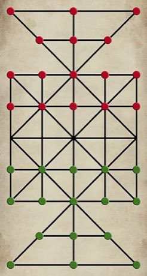

# Sholo Guti

*Also known as: ষোল গুটি · Sixteen Soldiers*

**Encyclopedia ID 461** (permanent) · https://bpupadhyaya.github.io/world-heritage-games-site/games/461-sholo-guti/

*Photo: Orko rudro, [CC BY-SA 4.0](https://creativecommons.org/licenses/by-sa/4.0/), [source on Wikimedia Commons](https://commons.wikimedia.org/wiki/File:%E0%A6%B7%E0%A7%8B%E0%A6%B2_%E0%A6%97%E0%A7%81%E0%A6%9F%E0%A6%BF_%E0%A6%9B%E0%A6%95.jpg)*

Each side has 16 stones on a board of crossed lines with two triangles; jump to capture and win by removing all your opponent's soldiers.

## Heritage note

Part of the living heritage of Bangladesh.

## Origins

Usually placed in the era of Crossroads and Golden Ages (about 500 to 1500), although its exact origins are uncertain, within the cultural world of South Asia.

## Facts

- **Where:** Bangladesh
- **Type:** Board and table games
- **Family:** Draughts and capture games
- **Era:** [Crossroads and Golden Ages](../../eras/crossroads/index.md) (uncertain)
- **Cradle:** [South Asia](../../cradles/south-asia/index.md)
- **Region:** South and Central Asia

## Play it

[Try a 90-second preview in your browser](https://bpupadhyaya.github.io/games-site/games/sholo-guti/play/) · [Google Play](https://play.google.com/store/apps/details?id=com.equalinformation.arcforge.shell) · [App Store](https://apps.apple.com/us/app/arcforge-world-heritage-games/id6813746442)

## Related entries

- [Peralikatuma](../../games/287-peralikatuma/index.md)
- [Turkish Dama](../../games/155-turkish-dama/index.md)
- [Yote Capture Grid](../../games/167-yote-capture-grid/index.md)
- [Kharbaga](../../games/459-kharbaga/index.md)
- [Zamma](../../games/462-zamma/index.md)
- [Checkers](../../games/567-checkers/index.md)

## Sources

- <https://commons.wikimedia.org/wiki/File:%E0%A6%B7%E0%A7%8B%E0%A6%B2_%E0%A6%97%E0%A7%81%E0%A6%9F%E0%A6%BF_%E0%A6%9B%E0%A6%95.jpg>
