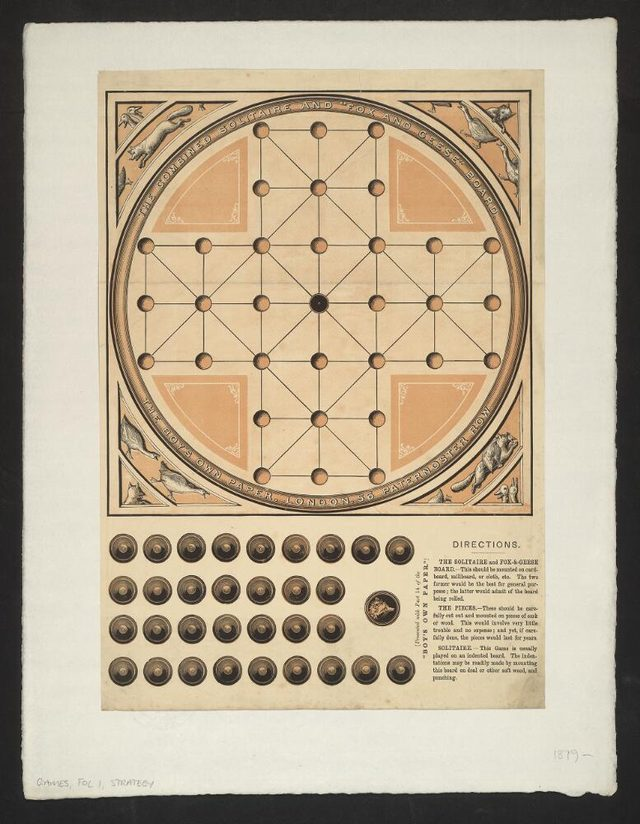

# Fox and Geese

**Encyclopedia ID 4615** (permanent) · https://bpupadhyaya.github.io/world-heritage-games-site/games/4615-fox-and-geese/

*Photo: The Boy's own paper [author], [Public domain](https://creativecommons.org/publicdomain/mark/1.0/), [source on Wikimedia Commons](https://commons.wikimedia.org/wiki/File:Bodleian_Libraries,_Combined_solitaire_and_Fox_and_geese_board.jpg)*

Fox and Geese is the classic hunt game, played on a cross of 33 points across Europe for centuries.

## How it is played

New here? The geese move first. The fox steps one point up, down, left or right, or jumps over a goose to the empty point behind it and captures it.

## Heritage note

Part of the living heritage of United Kingdom.

## Origins

Usually placed in the era of Crossroads and Golden Ages (about 500 to 1500), although its exact origins are uncertain, within the cultural world of Celtic and Atlantic Europe.

## Facts

- **Where:** United Kingdom
- **Type:** Board and table games
- **Family:** Hunt and blockade games
- **Era:** [Crossroads and Golden Ages](../../eras/crossroads/index.md) (uncertain)
- **Cradle:** [Celtic and Atlantic Europe](../../cradles/celtic-atlantic/index.md)
- **Region:** Europe

## Play it

[Try a 90-second preview in your browser](https://bpupadhyaya.github.io/games-site/games/fox-and-geese/play/) · [Google Play](https://play.google.com/store/apps/details?id=com.equalinformation.arcforge.shell) · [App Store](https://apps.apple.com/us/app/arcforge-world-heritage-games/id6813746442)

## Related entries

- [Hare and Hounds](../../games/4647-hare-and-hounds/index.md)
- [Lambs and Tigers](../../games/791-lambs-and-tigers/index.md)
- [Tiger and Goat](../../games/967-tiger-and-goat/index.md)
- [Croquet](../../games/81-croquet/index.md)
- [Racing Pigeon Loft](../../games/411-racing-pigeon-loft/index.md)
- [Highland Bagpipe Chanter and Drone](../../games/510-highland-bagpipe-chanter-and-drone/index.md)

## Sources

- <https://en.wikipedia.org/wiki/Fox_and_Geese>
