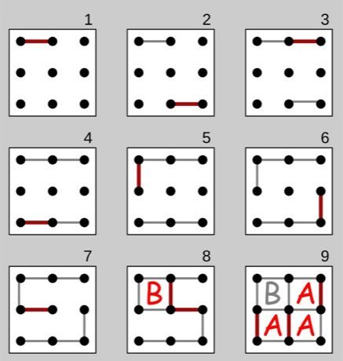

# Dots and Boxes

*Pipopipette · La Pipopipette*

**Encyclopedia ID 463** (permanent) · https://bpupadhyaya.github.io/world-heritage-games-site/games/463-dots-and-boxes/

*Photo: Tiger66, [CC BY-SA 3.0](https://creativecommons.org/licenses/by-sa/3.0/), [source on Wikimedia Commons](https://commons.wikimedia.org/wiki/File:Dots-and-boxes.svg)*

Players alternate drawing one line between two neighbouring dots; whoever closes the fourth side of a box claims it and moves again; most boxes wins.

## Heritage note

Part of the living heritage of France.

## Origins

A living tradition passed from person to person; it is not tied to a single dated origin. It belongs to the cultural world of Celtic and Atlantic Europe.

## Facts

- **Where:** France
- **Type:** Crafts and making
- **Family:** Paper, ink and painting crafts
- **Era:** [Living Traditions](../../eras/living/index.md)
- **Cradle:** [Celtic and Atlantic Europe](../../cradles/celtic-atlantic/index.md)
- **Region:** Europe

## Related entries

- [Ribbon-Pole Plaiting Dance](../../games/512-ribbon-pole-plaiting-dance/index.md)
- [Paper Fortune Teller](../../games/465-paper-fortune-teller/index.md)
- [Sprouts](../../games/473-sprouts/index.md)
- [Ebru paper marbling](../../games/20-ebru-paper-marbling/index.md)
- [Ndebele geometric wall painting](../../games/23-ndebele-geometric-wall-painting/index.md)
- [Chinese knotting](../../games/26-chinese-knotting/index.md)

## Sources

- <https://commons.wikimedia.org/wiki/File:Dots-and-boxes.svg>
