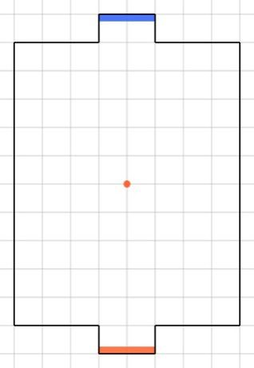

# Paper Soccer

*Also known as: Piłka nożna na kartce · Kropki · Fussball auf Papier*

**Encyclopedia ID 464** (permanent) · https://bpupadhyaya.github.io/world-heritage-games-site/games/464-paper-soccer/

*Photo: Scubatoad, [CC BY-SA 4.0](https://creativecommons.org/licenses/by-sa/4.0/), [source on Wikimedia Commons](https://commons.wikimedia.org/wiki/File:Paper_Soccer.png)*

On a pitch grid a shared ball moves one step at a time along a line, bouncing again whenever it lands on an already-used point; reach the opponent's goal mouth.

## Heritage note

Part of the living heritage of Poland, Germany, Russia.

## Origins

A living tradition passed from person to person; it is not tied to a single dated origin. It belongs to the cultural world of Northern and Eastern Europe.

## Facts

- **Where:** Poland, Germany, Russia
- **Type:** Crafts and making
- **Family:** Paper, ink and painting crafts
- **Era:** [Living Traditions](../../eras/living/index.md)
- **Cradle:** [Northern and Eastern Europe](../../cradles/north-east-europe/index.md)
- **Region:** Europe

## Related entries

- [Matryoshka](../../games/28-matryoshka/index.md)
- [Khokhloma Pattern Painting](../../games/102-khokhloma-pattern-painting/index.md)
- [Kurpie Layered Paper Cutting](../../games/1320-kurpie-layered-paper-cutting/index.md)
- [Zhostovo painting](../../games/4460-zhostovo-painting/index.md)
- [Malarstwo Zalipia](../../games/19992-malarstwo-zalipia/index.md)
- [Rosemaling](../../games/120-rosemaling/index.md)

## Sources

- <https://commons.wikimedia.org/wiki/File:Paper_Soccer.png>
