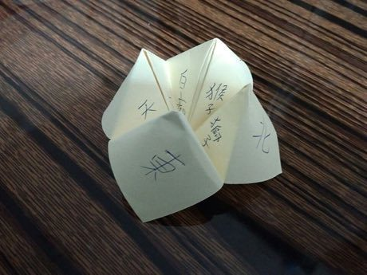

# Paper Fortune Teller

*Also known as: Himmel und Holle (German name; use neutral title) · Cootie Catcher · Chatterbox*

**Encyclopedia ID 465** (permanent) · https://bpupadhyaya.github.io/world-heritage-games-site/games/465-paper-fortune-teller/

*Photo: Richard923888, [CC BY-SA 4.0](https://creativecommons.org/licenses/by-sa/4.0/), [source on Wikimedia Commons](https://commons.wikimedia.org/wiki/File:Paper_fortune_teller.jpg)*

Fold a square into a four-flap pincher, choose colours and numbers, and open flaps to reveal a hidden message.

## Heritage note

Part of the living heritage of United Kingdom, United States, Germany. Some forms of this practice carry deep meaning for the communities who keep it; here we describe the play and the craft only, with respect for its roots. Animals are partners in this tradition; good care and local rules always come first.

## Origins

A living tradition passed from person to person; it is not tied to a single dated origin. It belongs to the cultural world of Celtic and Atlantic Europe.

## Facts

- **Where:** United Kingdom, United States, Germany, Japan
- **Type:** Crafts and making
- **Family:** Paper, ink and painting crafts
- **Era:** [Living Traditions](../../eras/living/index.md)
- **Cradle:** [Celtic and Atlantic Europe](../../cradles/celtic-atlantic/index.md)
- **Region:** Europe

## Related entries

- [Sprouts](../../games/473-sprouts/index.md)
- [Ribbon-Pole Plaiting Dance](../../games/512-ribbon-pole-plaiting-dance/index.md)
- [Dots and Boxes](../../games/463-dots-and-boxes/index.md)
- [Ebru paper marbling](../../games/20-ebru-paper-marbling/index.md)
- [Ndebele geometric wall painting](../../games/23-ndebele-geometric-wall-painting/index.md)
- [Chinese knotting](../../games/26-chinese-knotting/index.md)

## Sources

- <https://commons.wikimedia.org/wiki/File:Paper_fortune_teller.jpg>
