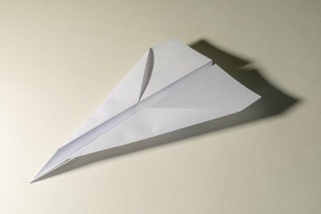

# Paper Plane Flight Contest

*Also known as: Kamihikoki (Japan), Papierflieger*

**Encyclopedia ID 466** (permanent) · https://bpupadhyaya.github.io/world-heritage-games-site/games/466-paper-plane-flight-contest/

*Photo: Dietmar Rabich, [CC BY-SA 4.0](https://creativecommons.org/licenses/by-sa/4.0/), [source on Wikimedia Commons](https://commons.wikimedia.org/wiki/File:Papierflieger_--_2021_--_7215.jpg)*

Fold one of several classic paper-plane designs, tune wing bends, and throw for distance, hang-time or accuracy.

## Heritage note

Part of the living heritage of Japan.

## Origins

A living tradition passed from person to person; it is not tied to a single dated origin. It belongs to the cultural world of Japan and Korea.

## Facts

- **Where:** Japan
- **Type:** Crafts and making
- **Family:** Paper, ink and painting crafts
- **Era:** [Living Traditions](../../eras/living/index.md)
- **Cradle:** [Japan and Korea](../../cradles/japan-korea/index.md)
- **Region:** East and Southeast Asia

## Related entries

- [Temari Thread-Ball Patterns](../../games/96-temari-thread-ball-patterns/index.md)
- [Kumiko lattice](../../games/97-kumiko-lattice/index.md)
- [Shibori Indigo Fold](../../games/106-shibori-indigo-fold/index.md)
- [Kumihimo Braid Disk](../../games/107-kumihimo-braid-disk/index.md)
- [Kokeshi doll painting](../../games/355-kokeshi-doll-painting/index.md)
- [Washi Papermaking](../../games/497-washi-papermaking/index.md)

## Sources

- <https://commons.wikimedia.org/wiki/File:Papierflieger_--_2021_--_7215.jpg>
