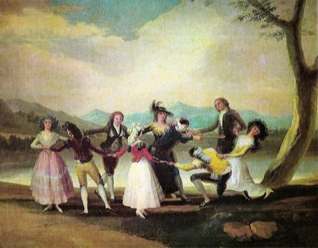

# Blind Man's Buff

*Also known as: Gallina ciega, Blindekuh, Colin-Maillard, Kore-be · Colin-Maillard*

**Encyclopedia ID 467** (permanent) · https://bpupadhyaya.github.io/world-heritage-games-site/games/467-blind-mans-buff/

*Photo: Francisco Goya, [Public domain](https://creativecommons.org/publicdomain/mark/1.0/), [source on Wikimedia Commons](https://commons.wikimedia.org/wiki/File:La_gallina_ciega_(Goya).jpg)*

A blindfolded seeker stumbles around, guided only by sounds and claps, to catch and identify the others.

## Heritage note

Part of the living heritage of Turkey, India.

## Origins

Usually placed in the era of Modern Heritage (1800 to today), although its exact origins are uncertain, within the cultural world of Mesopotamia, Levant and Arabia.

## Facts

- **Where:** Turkey, India
- **Type:** Street and playground games
- **Family:** Tag, chase and hide games
- **Era:** [Modern Heritage](../../eras/modern/index.md) (uncertain)
- **Cradle:** [Mesopotamia, Levant and Arabia](../../cradles/mesopotamia-levant/index.md)
- **Region:** Middle East and North Africa

## Related entries

- [Kho-Kho](../../games/15-kho-kho/index.md)
- [Cheese Rolling Hill](../../games/70-cheese-rolling-hill/index.md)
- [Otedama](../../games/131-otedama/index.md)
- [Hand-slap game](../../games/711-hand-slap-game/index.md)
- [Kabaddi](../../games/789-kabaddi/index.md)
- [Stick game](../../games/912-stick-game/index.md)

## Sources

- <https://commons.wikimedia.org/wiki/File:La_gallina_ciega_(Goya).jpg>
