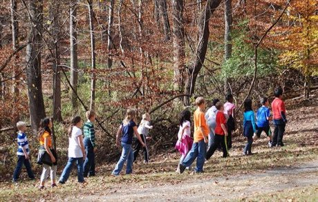

# Grandmother's Footsteps

*What's the Time Mr Wolf, Estatua, Mugunghwa, Un Deux Trois Soleil · Red Light, Green Light*

**Encyclopedia ID 469** (permanent) · https://bpupadhyaya.github.io/world-heritage-games-site/games/469-grandmothers-footsteps/

*Photo: Jarek Tuszynski, [CC BY-SA 3.0](https://creativecommons.org/licenses/by-sa/3.0/), [source on Wikimedia Commons](https://commons.wikimedia.org/wiki/File:Hemlock_Overlook_-_Red_light_Green_light_-_01.jpg)*

The watcher turns away while the others creep forward; when the watcher spins round anyone seen moving goes back.

## Heritage note

Part of the living heritage of United Kingdom, France, South Korea.

## Origins

A living tradition passed from person to person; it is not tied to a single dated origin. It belongs to the cultural world of Celtic and Atlantic Europe.

## Facts

- **Where:** United Kingdom, France, South Korea
- **Type:** Other traditions
- **Era:** [Living Traditions](../../eras/living/index.md) (uncertain)
- **Cradle:** [Celtic and Atlantic Europe](../../cradles/celtic-atlantic/index.md)
- **Region:** Europe

## Related entries

- [Celtic knot weave](../../games/25-celtic-knot-weave/index.md)
- [Hurdy-gurdy](../../games/153-hurdy-gurdy/index.md)
- [Nordic Colourwork Knitting](../../games/413-nordic-colourwork-knitting/index.md)
- [Welsh Love Spoon Carving](../../games/414-welsh-love-spoon-carving/index.md)
- [Ribbon Pole Weave](../../games/419-ribbon-pole-weave/index.md)
- [Dots and Boxes](../../games/463-dots-and-boxes/index.md)

## Sources

- <https://commons.wikimedia.org/wiki/File:Hemlock_Overlook_-_Red_light_Green_light_-_01.jpg>
