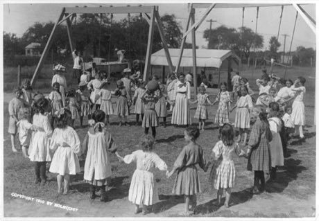

# Circle Dodgeball

*Queimada, Volkerball, Palla avvelenata, Dwa ognie · Queimada / Volkerball / Palla avvelenata*

**Encyclopedia ID 470** (permanent) · https://bpupadhyaya.github.io/world-heritage-games-site/games/470-circle-dodgeball/

*Photo: Library of Congress, [Public domain](https://creativecommons.org/publicdomain/mark/1.0/), [source on Wikimedia Commons](https://commons.wikimedia.org/wiki/File:Girls'_dodge_ball_game_on_school_playground._Girls_standing_in_circle_and_girl_in_middle_holding_ball_LCCN2003655391.jpg)*

One team throws a soft ball to hit opponents in the arena who dodge or catch to revive; last team standing wins.

## Heritage note

Part of the living heritage of Brazil, Germany, Italy.

## Origins

Usually placed in the era of Classical Worlds (about 1000 BCE to 500 CE), although its exact origins are uncertain, within the cultural world of The Americas: Andes and South America.

## Facts

- **Where:** Brazil, Germany, Italy, Poland
- **Type:** Archery, throwing and target games
- **Family:** Tag, chase and hide games
- **Era:** [Classical Worlds](../../eras/classical/index.md) (uncertain)
- **Cradle:** [The Americas: Andes and South America](../../cradles/andes-south-america/index.md)
- **Region:** Americas

## Related entries

- [Moraingy drum-and-strike duel](../../games/207-moraingy-drum-and-strike-duel/index.md)
- [Al Ayyala Cane-Line Rhythm](../../games/1272-al-ayyala-cane-line-rhythm/index.md)
- [Kalinda Stick Duel](../../games/1467-kalinda-stick-duel/index.md)
- [Kyz Kuu](../../games/858-kyz-kuu/index.md)
- [Fireball](../../games/1016-fireball/index.md)
- [Kho-Kho](../../games/15-kho-kho/index.md)

## Sources

- <https://commons.wikimedia.org/wiki/File:Girls'_dodge_ball_game_on_school_playground._Girls_standing_in_circle_and_girl_in_middle_holding_ball_LCCN2003655391.jpg>
