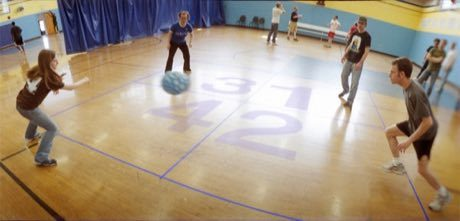

# Four Square

**Encyclopedia ID 471** (permanent) · https://bpupadhyaya.github.io/world-heritage-games-site/games/471-four-square/

*Photo: Seaneffel, [CC BY-SA 3.0](https://creativecommons.org/licenses/by-sa/3.0/), [source on Wikimedia Commons](https://commons.wikimedia.org/wiki/File:Four_square_court.jpg)*

Four players in numbered squares bounce a ball into each other's squares with their hands; a fault sends you to the lowest square and the line moves up.

## Heritage note

Part of the living heritage of United States.

## Origins

A living tradition passed from person to person; it is not tied to a single dated origin. It belongs to the cultural world of The Americas: North America.

## Facts

- **Where:** United States
- **Type:** Other traditions
- **Era:** [Living Traditions](../../eras/living/index.md) (uncertain)
- **Cradle:** [The Americas: North America](../../cradles/north-america/index.md)
- **Region:** Americas

## Related entries

- [Rubboard zydeco rhythm](../../games/437-rubboard-zydeco-rhythm/index.md)
- [American patchwork quilting](../../games/6356-american-patchwork-quilting/index.md)
- [Maple taffy on snow](../../games/441-maple-taffy-on-snow/index.md)
- [Ice Canoe Race](../../games/1412-ice-canoe-race/index.md)
- [Horseshoe pitching](../../games/50-horseshoe-pitching/index.md)
- [Double Dutch](../../games/53-double-dutch/index.md)

## Sources

- <https://commons.wikimedia.org/wiki/File:Four_square_court.jpg>
