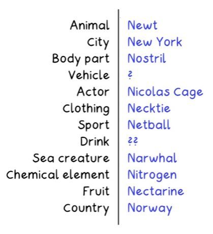

# Letter Categories

*Stadt Land Fluss, Basta, Tutti Frutti, Petit Bac, Adedonha · Name Place Animal Thing / Basta / Stadt Land Fluss*

**Encyclopedia ID 472** (permanent) · https://bpupadhyaya.github.io/world-heritage-games-site/games/472-letter-categories/

*Photo: Lord Belbury, [Public domain](https://creativecommons.org/publicdomain/mark/1.0/), [source on Wikimedia Commons](https://commons.wikimedia.org/wiki/File:Example_Categories_game.png)*

A random letter is drawn and players race to fill category boxes (country, animal, name, etc.) with words starting with it; unique answers score most.

## Heritage note

Part of the living heritage of Germany, India, France. Animals are partners in this tradition; good care and local rules always come first.

## Origins

Usually placed in the era of Age of Contact and Craft (about 1500 to 1800), although its exact origins are uncertain, within the cultural world of Northern and Eastern Europe.

## Facts

- **Where:** Germany, India, France, Brazil
- **Type:** Racing
- **Era:** [Age of Contact and Craft](../../eras/contact/index.md) (uncertain)
- **Cradle:** [Northern and Eastern Europe](../../cradles/north-east-europe/index.md)
- **Region:** Europe

## Related entries

- [Gorodki](../../games/13-gorodki/index.md)
- [Finnish pin toss](../../games/49-finnish-pin-toss/index.md)
- [Oina](../../games/376-oina/index.md)
- [Partner-Carry Obstacle Race](../../games/406-partner-carry-obstacle-race/index.md)
- [Kicksled Race](../../games/407-kicksled-race/index.md)
- [Danish pin billiards](../../games/671-danish-pin-billiards/index.md)

## Sources

- <https://commons.wikimedia.org/wiki/File:Example_Categories_game.png>
