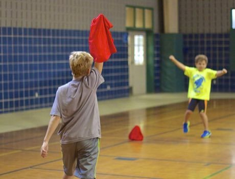

# Steal the Flag

*Ruba bandiera, Barra bandeira, Capture the numbers · Ruba Bandiera*

**Encyclopedia ID 474** (permanent) · https://bpupadhyaya.github.io/world-heritage-games-site/games/474-steal-the-flag/

*Photo: Lydia Liu, [CC BY 2.0](https://creativecommons.org/licenses/by/2.0/), [source on Wikimedia Commons](https://commons.wikimedia.org/wiki/File:Boys_Playing_Capture_the_Flag_(14980437786).jpg)*

Two teams with numbered players face each other; a referee calls a number and those two sprint to snatch the flag in the middle and get back untagged.

## Heritage note

Part of the living heritage of Italy, Brazil, Spain.

## Origins

A living tradition passed from person to person; it is not tied to a single dated origin. It belongs to the cultural world of Mediterranean.

## Facts

- **Where:** Italy, Brazil, Spain
- **Type:** Other traditions
- **Era:** [Living Traditions](../../eras/living/index.md) (uncertain)
- **Cradle:** [Mediterranean](../../cradles/mediterranean/index.md)
- **Region:** Europe

## Related entries

- [Glassblowing](../../games/121-glassblowing/index.md)
- [Txalaparta Duet](../../games/390-txalaparta-duet/index.md)
- [Sicilian Cart Painting](../../games/399-sicilian-cart-painting/index.md)
- [Launeddas Triple Pipe](../../games/400-launeddas-triple-pipe/index.md)
- [Dry Stone Wall Builder](../../games/404-dry-stone-wall-builder/index.md)
- [Tamburello](../../games/489-tamburello/index.md)

## Sources

- <https://commons.wikimedia.org/wiki/File:Boys_Playing_Capture_the_Flag_(14980437786).jpg>
