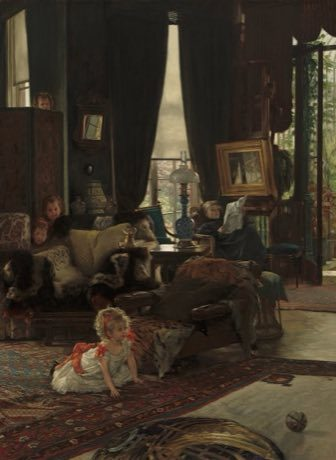

# Hide and Seek

*Nascondino, Petak umpet, Kakurenbo, Escondidas · Nascondino / Petak Umpet / Kakurenbo*

**Encyclopedia ID 475** (permanent) · https://equalinformation.com/world-heritage-games-site/games/475-hide-and-seek/

*Photo: James Tissot, [CC0](https://creativecommons.org/publicdomain/zero/1.0/), [source on Wikimedia Commons](https://commons.wikimedia.org/wiki/File:James_Jacques_Joseph_Tissot,_Hide_and_Seek,_c._1877,_NGA_56669.jpg)*

One seeker counts while others hide; the seeker searches and the first found is next seeker.

## Heritage note

A tradition shared by communities in many places.

## Origins

Usually placed in the era of Deep Past and First Games (before about 3000 BCE), although its exact origins are uncertain.

## Facts

- **Where:** Shared across many places
- **Type:** Street and playground games
- **Family:** Tag, chase and hide games
- **Era:** [Deep Past and First Games](../../eras/deep-past/index.md) (uncertain)
- **Cradle:** [Shared across the world](../../cradles/worldwide/index.md)
- **Region:** Worldwide

## Related entries

- [Ziziros](../../games/659-ziziros/index.md)
- [Fijian tag](../../games/712-fijian-tag/index.md)
- [Galah panjang](../../games/909-galah-panjang/index.md)
- [Baibalaa](../../games/914-baibalaa/index.md)
- [Tag](../../games/959-tag/index.md)
- [Patintero](../../games/1021-patintero/index.md)

## Sources

- <https://commons.wikimedia.org/wiki/File:James_Jacques_Joseph_Tissot,_Hide_and_Seek,_c._1877,_NGA_56669.jpg>
