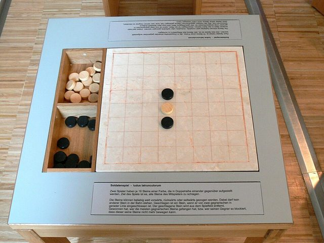

# Ludus Latrunculorum

**Encyclopedia ID 4756** (permanent) · https://bpupadhyaya.github.io/world-heritage-games-site/games/4756-ludus-latrunculorum/

*Photo: Wolfgang Sauber, [CC BY-SA 3.0](https://creativecommons.org/licenses/by-sa/3.0/), [source on Wikimedia Commons](https://commons.wikimedia.org/wiki/File:Museum_Quintana_-_R%C3%A4uberspiel.jpg)*

The Roman game of little soldiers on a marble board with pieces of bone and glass.

## How it is played

Each side has 15 soldiers and a dux. Ivory moves first. Slide one piece a turn along its row or column over empty squares, like a rook. Sandwich an enemy soldier between two of your pieces, in a row or column, to take it.

## Heritage note

Part of the living heritage of Italy.

## Origins

Usually placed in the era of Crossroads and Golden Ages (about 500 to 1500), although its exact origins are uncertain, within the cultural world of Mediterranean.

## Facts

- **Where:** Italy
- **Type:** Board and table games
- **Era:** [Crossroads and Golden Ages](../../eras/crossroads/index.md) (uncertain)
- **Cradle:** [Mediterranean](../../cradles/mediterranean/index.md)
- **Region:** Europe

## Play it

[Try a 90-second preview in your browser](https://bpupadhyaya.github.io/games-site/games/latrunculi-roman/play/) · [Google Play](https://play.google.com/store/apps/details?id=com.equalinformation.arcforge.shell) · [App Store](https://apps.apple.com/us/app/arcforge-world-heritage-games/id6813746442)

## Related entries

- [Italian draughts](../../games/834-italian-draughts/index.md)
- [Rithmomachia](../../games/8869-rithmomachia/index.md)
- [Kharbaga](../../games/459-kharbaga/index.md)
- [Zamma](../../games/462-zamma/index.md)
- [Çiftelia](../../games/1257-ciftelia/index.md)
- [Mezoued Bagpipe and Tabl Drum](../../games/1336-mezoued-bagpipe-and-tabl-drum/index.md)

## Sources

- <https://en.wikipedia.org/wiki/Ludus_Latrunculorum>
