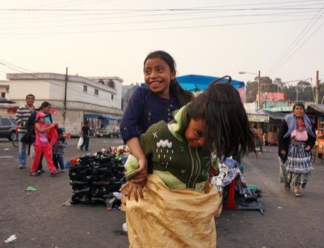

# Sack Race

*Also known as: Balap Karung, Carrera de sacos · Balap Karung*

**Encyclopedia ID 476** (permanent) · https://bpupadhyaya.github.io/world-heritage-games-site/games/476-sack-race/

*Photo: Erik Albers, [CC0](https://creativecommons.org/publicdomain/zero/1.0/), [source on Wikimedia Commons](https://commons.wikimedia.org/wiki/File:Mayan_girls_playing_sack_race_on_the_market_of_Quetzaltenango,_Guatemala.JPG)*

Players stand inside sacks and hop to the finish; first across wins.

## Heritage note

Part of the living heritage of Indonesia, United Kingdom.

## Origins

Usually placed in the era of Age of Contact and Craft (about 1500 to 1800), although its exact origins are uncertain, within the cultural world of Southeast Asia and the Islands.

## Facts

- **Where:** Indonesia, United Kingdom
- **Type:** Racing
- **Era:** [Age of Contact and Craft](../../eras/contact/index.md) (uncertain)
- **Cradle:** [Southeast Asia and the Islands](../../cradles/southeast-asia/index.md)
- **Region:** East and Southeast Asia

## Related entries

- [Bakiak](../../games/324-bakiak/index.md)
- [Independence-day field games](../../games/330-independence-day-field-games/index.md)
- [Pacu jawi](../../games/1354-pacu-jawi/index.md)
- [Intha leg rowing on the lake](../../games/304-intha-leg-rowing-on-the-lake/index.md)
- [Thung chai basket-boat spinning](../../games/308-thung-chai-basket-boat-spinning/index.md)
- [Egrang](../../games/17-egrang/index.md)

## Sources

- <https://commons.wikimedia.org/wiki/File:Mayan_girls_playing_sack_race_on_the_market_of_Quetzaltenango,_Guatemala.JPG>
