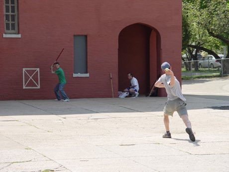

# Stickball

*Also known as: Street Stickball · Stoopball*

**Encyclopedia ID 477** (permanent) · https://bpupadhyaya.github.io/world-heritage-games-site/games/477-stickball/

*Photo: Ravi Misra, [Public domain](https://creativecommons.org/publicdomain/mark/1.0/), [source on Wikimedia Commons](https://commons.wikimedia.org/wiki/File:Queens_stickball.jpg)*

Hit a rubber ball with a broomstick down the street and run or score by manholes; stoopball variant bounces off steps.

## Heritage note

Part of the living heritage of Cuba.

## Origins

Usually placed in the era of Modern Heritage (1800 to today), although its exact origins are uncertain, within the cultural world of The Americas: Caribbean.

## Facts

- **Where:** Cuba
- **Type:** Bat-and-ball games
- **Era:** [Modern Heritage](../../eras/modern/index.md) (uncertain)
- **Cradle:** [The Americas: Caribbean](../../cradles/caribbean/index.md)
- **Region:** Americas

## Related entries

- [Four Corners](../../games/652-four-corners/index.md)
- [Burn-out](../../games/654-burn-out/index.md)
- [Limbo](../../games/58-limbo/index.md)
- [Spinning top](../../games/678-spinning-top/index.md)
- [Handkerchief game](../../games/683-handkerchief-game/index.md)
- [Rounders](../../games/761-rounders/index.md)

## Sources

- <https://commons.wikimedia.org/wiki/File:Queens_stickball.jpg>
