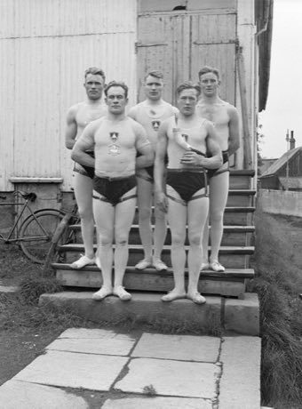

# Glima

*Also known as: Icelandic belt wrestling*

**Encyclopedia ID 478** (permanent) · https://bpupadhyaya.github.io/world-heritage-games-site/games/478-glima/

*Photo: Willem van de Poll, [CC0](https://creativecommons.org/publicdomain/zero/1.0/), [source on Wikimedia Commons](https://commons.wikimedia.org/wiki/File:Reykjavik._IJslands_worstelen_(Glima)._Leden_van_het_glimateam_van_de_Menntaskol,_Bestanddeelnr_190-0267.jpg)*

Two players hold belt-and-thigh straps and try to trip each other with leg hooks and lifts while staying upright; throws are scored for clean technique, falling first loses the round.

## Heritage note

Part of the living heritage of Iceland.

## Origins

Usually placed in the era of River Valleys and First Cities (about 3000 to 1000 BCE), although its exact origins are uncertain, within the cultural world of Celtic and Atlantic Europe.

## Facts

- **Where:** Iceland
- **Type:** Wrestling and martial sports
- **Family:** Wrestling
- **Era:** [River Valleys and First Cities](../../eras/river-valleys/index.md) (uncertain)
- **Cradle:** [Celtic and Atlantic Europe](../../cradles/celtic-atlantic/index.md)
- **Region:** Europe

## Play it

[Try a 90-second preview in your browser](https://bpupadhyaya.github.io/games-site/games/glima/play/) · [Google Play](https://play.google.com/store/apps/details?id=com.equalinformation.arcforge.shell) · [App Store](https://apps.apple.com/us/app/arcforge-world-heritage-games/id6813746442)

## Related entries

- [Laamb Wrestling Bout](../../games/166-laamb-wrestling-bout/index.md)
- [Kurash](../../games/253-kurash/index.md)
- [Kushti / Pehlwani mud wrestling](../../games/256-kushti-pehlwani-mud-wrestling/index.md)
- [Sumo bout](../../games/359-sumo-bout/index.md)
- [Ssireum](../../games/366-ssireum/index.md)
- [Bökh](../../games/374-bokh/index.md)

## Sources

- <https://commons.wikimedia.org/wiki/File:Reykjavik._IJslands_worstelen_(Glima)._Leden_van_het_glimateam_van_de_Menntaskol,_Bestanddeelnr_190-0267.jpg>
