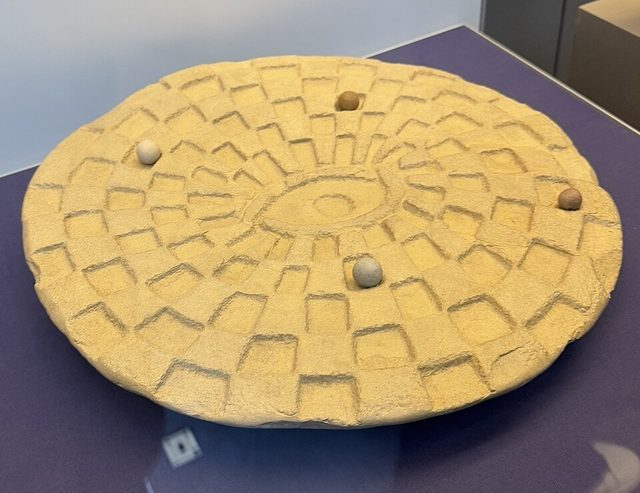

# Mehen

**Encyclopedia ID 4785** (permanent) · https://bpupadhyaya.github.io/world-heritage-games-site/games/4785-mehen/

*Photo: Waltros, [CC0](https://creativecommons.org/publicdomain/zero/1.0/), [source on Wikimedia Commons](https://commons.wikimedia.org/wiki/File:British_Museum_Mehen_Board.jpg)*

Mehen is an ancient Egyptian board game played on a circular board carved as a coiled snake, with the head at the centre and the body divided into spaces. It takes its name from the serpent of Egyptian myth that coiled around the sun's journey to protect it. The game was popular in the early dynasties and the Old Kingdom, from about 3000 to 2300 BCE, and then disappeared from the record, and it has been found in tombs in Egypt as well as at sites in the Levant.

## How it is played

Players race pieces shaped as lions and lionesses, with marbles also used in play, from the tail of the snake to the head at the centre. Moves were probably decided by throwing sticks or dice, though the exact method is not known, and pieces move along the segments of the coiled body toward the centre. Reconstructions, based on tomb scenes and the finds of boards, pieces and marbles, use captures that send a rival back to the start. The first to bring home all pieces wins.

## Heritage note

Stone mehen boards have been found in cemeteries, and several tomb paintings at Saqqara show people playing the game, usually seated on the ground with the board between them. The game appears in Egyptian funerary texts alongside the senet game, which suggests it carried meaning beyond play. It is one of the oldest board games known and also one of the most puzzling, because the original rules were never written down, and different modern researchers have proposed different reconstructions based on the evidence.

## Origins

Attested in Egypt from the Predynastic and Early Dynastic periods, through the Old Kingdom; boards and pieces have also been found in the Levant.

## Facts

- **Where:** Egypt
- **Type:** Board and table games
- **Family:** Race and cross games
- **Era:** [Crossroads and Golden Ages](../../eras/crossroads/index.md) (uncertain)
- **Cradle:** [Africa: Nile and the Horn](../../cradles/africa-nile/index.md)
- **Region:** Middle East and North Africa

## Play it

[Try a 90-second preview in your browser](https://bpupadhyaya.github.io/games-site/games/mehen-coiled-snake-race/play/) · [Google Play](https://play.google.com/store/apps/details?id=com.equalinformation.arcforge.shell) · [App Store](https://apps.apple.com/us/app/arcforge-world-heritage-games/id6813746442)

## Related entries

- [Senet](../../games/693-senet/index.md)
- [Don't Get Mad](../../games/530-dont-get-mad/index.md)
- [Egyptian backgammon](../../games/695-egyptian-backgammon/index.md)
- [Cafe dominoes](../../games/690-cafe-dominoes/index.md)
- [Nardi](../../games/551-nardi/index.md)
- [Tavli](../../games/656-tavli/index.md)

## Sources

- <https://en.wikipedia.org/wiki/Mehen_(game)>
