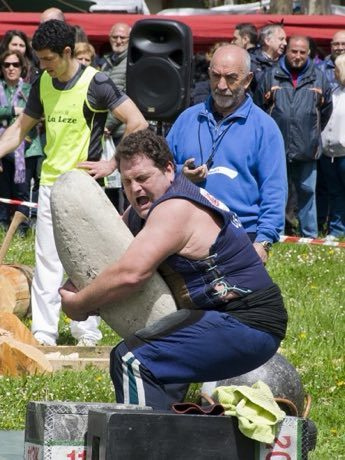

# Basque stone lifting

*Harri-jasotzea · harri-jasotzaile*

**Encyclopedia ID 479** (permanent) · https://bpupadhyaya.github.io/world-heritage-games-site/games/479-basque-stone-lifting/

*Photo: Alberto Cabello from Vitoria Gasteiz, [CC BY 2.0](https://creativecommons.org/licenses/by/2.0/), [source on Wikimedia Commons](https://commons.wikimedia.org/wiki/File:Harrijasotzaile_(26661583631).jpg)*

Lift a heavy rounded stone from ground to shoulder as many times as possible in a fixed time, choosing stone size before each attempt.

## Heritage note

Part of the living heritage of France.

## Origins

Usually placed in the era of Classical Worlds (about 1000 BCE to 500 CE), although its exact origins are uncertain, within the cultural world of Celtic and Atlantic Europe.

## Facts

- **Where:** France
- **Type:** Acrobatics and strength
- **Era:** [Classical Worlds](../../eras/classical/index.md) (uncertain)
- **Cradle:** [Celtic and Atlantic Europe](../../cradles/celtic-atlantic/index.md)
- **Region:** Europe

## Related entries

- [Boules lyonnaises](../../games/730-boules-lyonnaises/index.md)
- [Lawn bowls](../../games/74-lawn-bowls/index.md)
- [Kolf](../../games/491-kolf/index.md)
- [Langspil](../../games/1323-langspil/index.md)
- [Krulbol](../../games/1469-krulbol/index.md)
- [Provencal boules](../../games/939-provencal-boules/index.md)

## Sources

- <https://commons.wikimedia.org/wiki/File:Harrijasotzaile_(26661583631).jpg>
