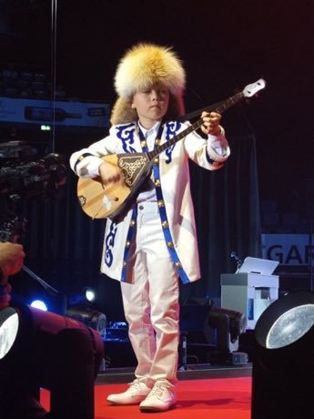

# Dombra

*Also known as: Домбыра · dombyra · two-string lute kuy*

**Encyclopedia ID 48** (permanent) · https://bpupadhyaya.github.io/world-heritage-games-site/games/48-dombra/

*Photo: Cool, [CC BY-SA 4.0](https://creativecommons.org/licenses/by-sa/4.0/), [source on Wikimedia Commons](https://commons.wikimedia.org/wiki/File:IFLC_Festival_-_Boy_playing_dombra_in_traditional_Kazakh_clothing.jpg)*

Strum and finger two strings in fast rhythmic patterns to play galloping steppe pieces (kuy), following scrolling notes and strumming gestures.

## Heritage note

Part of the living heritage of Kazakhstan. Some forms of this practice carry deep meaning for the communities who keep it; here we describe the play and the craft only, with respect for its roots.

## Origins

Usually placed in the era of Crossroads and Golden Ages (about 500 to 1500), although its exact origins are uncertain, within the cultural world of Persia, Caucasus and Central Asia.

## Facts

- **Where:** Kazakhstan
- **Type:** Musical instruments
- **Family:** String instruments
- **Era:** [Crossroads and Golden Ages](../../eras/crossroads/index.md) (uncertain)
- **Cradle:** [Persia, Caucasus and Central Asia](../../cradles/persia-central-asia/index.md)
- **Region:** South and Central Asia

## Related entries

- [Komuz](../../games/242-komuz/index.md)
- [Tar and mugham modes](../../games/247-tar-and-mugham-modes/index.md)
- [Chonguri](../../games/255-chonguri/index.md)
- [Afghan Rubab Strings](../../games/1224-afghan-rubab-strings/index.md)
- [Charango](../../games/55-charango/index.md)
- [Erhu Two-String Fiddle](../../games/139-erhu-two-string-fiddle/index.md)

## Sources

- <https://commons.wikimedia.org/wiki/File:IFLC_Festival_-_Boy_playing_dombra_in_traditional_Kazakh_clothing.jpg>
