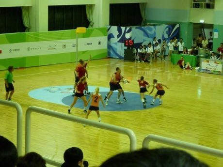

# Korfball

*Also known as: Korfbal*

**Encyclopedia ID 481** (permanent) · https://bpupadhyaya.github.io/world-heritage-games-site/games/481-korfball/

*Photo: 仰育 (Dennis Ho), [CC BY-SA 3.0](https://creativecommons.org/licenses/by-sa/3.0/), [source on Wikimedia Commons](https://commons.wikimedia.org/wiki/File:WG_Kaohsiung_-_Korfball_-_BEL_vs._NED_1.JPG)*

Mixed teams of four attackers and four defenders shoot at a post-mounted basket with no dribbling; roles swap every two goals.

## Heritage note

Part of the living heritage of Netherlands, Belgium, Taiwan.

## Origins

Usually placed in the era of Modern Heritage (1800 to today), although its exact origins are uncertain, within the cultural world of Celtic and Atlantic Europe.

## Facts

- **Where:** Netherlands, Belgium, Taiwan
- **Type:** Team ball sports
- **Era:** [Modern Heritage](../../eras/modern/index.md) (uncertain)
- **Cradle:** [Celtic and Atlantic Europe](../../cradles/celtic-atlantic/index.md)
- **Region:** Europe

## Related entries

- [Canal pole vault](../../games/7-canal-pole-vault/index.md)
- [Sjoelen](../../games/9-sjoelen/index.md)
- [Krulbollen](../../games/583-krulbollen/index.md)
- [Fierljeppen](../../games/971-fierljeppen/index.md)
- [Klootschieten](../../games/975-klootschieten/index.md)
- [Balle pelote](../../games/580-balle-pelote/index.md)

## Sources

- <https://commons.wikimedia.org/wiki/File:WG_Kaohsiung_-_Korfball_-_BEL_vs._NED_1.JPG>
