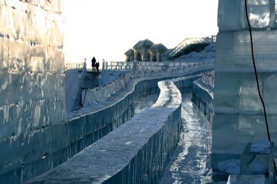

# Luge and toboggan run

*Also known as: Rodel*

**Encyclopedia ID 482** (permanent) · https://bpupadhyaya.github.io/world-heritage-games-site/games/482-luge-and-toboggan-run/

*Photo: Sandro Halank, Wikimedia Commons, [CC BY-SA 4.0](https://creativecommons.org/licenses/by-sa/4.0/), [source on Wikimedia Commons](https://commons.wikimedia.org/wiki/File:2022-02-18_FIL_Luge_World_Cup_Natural_Track_in_Mariazell_2021-22_by_Sandro_Halank%E2%80%93126.jpg)*

Lie back on a sled, steer by weight shifts through a banked ice track, shaving hundredths of a second per bend.

## Heritage note

A tradition shared by communities in many places.

## Origins

Usually placed in the era of Age of Contact and Craft (about 1500 to 1800), although its exact origins are uncertain.

## Facts

- **Where:** Shared across many places
- **Type:** Racing
- **Family:** Winter sports
- **Era:** [Age of Contact and Craft](../../eras/contact/index.md) (uncertain)
- **Cradle:** [Shared across the world](../../cradles/worldwide/index.md)
- **Region:** Europe

## Play it

[Try a 90-second preview in your browser](https://bpupadhyaya.github.io/games-site/games/luge-and-toboggan-run/play/) · [Google Play](https://play.google.com/store/apps/details?id=com.equalinformation.arcforge.shell) · App Store (coming soon)

## Related entries

- ['Ulu Maika](../../games/44-ulu-maika/index.md)
- [Finnish pin toss](../../games/49-finnish-pin-toss/index.md)
- [Sled dog race](../../games/62-sled-dog-race/index.md)
- [Canal ice-skating marathon](../../games/84-canal-ice-skating-marathon/index.md)
- [Kicksled Race](../../games/407-kicksled-race/index.md)
- [Candlepin bowling](../../games/444-candlepin-bowling/index.md)

## Sources

- <https://commons.wikimedia.org/wiki/File:2022-02-18_FIL_Luge_World_Cup_Natural_Track_in_Mariazell_2021-22_by_Sandro_Halank%E2%80%93126.jpg>
