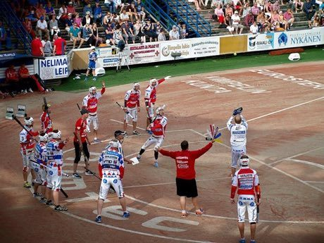

# Pesapallo

*Pesäpallo · Finnish baseball*

**Encyclopedia ID 484** (permanent) · https://equalinformation.com/world-heritage-games-site/games/484-pesapallo/

*Photo: Santeri Viinamäki, [CC BY 3.0](https://creativecommons.org/licenses/by/3.0/), [source on Wikimedia Commons](https://commons.wikimedia.org/wiki/File:Veto_-_Kossu_(1.8.2014)_07.JPG)*

The pitcher throws vertically over the plate and the batter runs a zigzag course of bases, trying to score before the fielders return the ball.

## Heritage note

Part of the living heritage of Finland.

## Origins

Usually placed in the era of Modern Heritage (1800 to today), although its exact origins are uncertain, within the cultural world of Northern and Eastern Europe.

## Facts

- **Where:** Finland
- **Type:** Racing
- **Family:** Bat-and-ball games
- **Era:** [Modern Heritage](../../eras/modern/index.md) (uncertain)
- **Cradle:** [Northern and Eastern Europe](../../cradles/north-east-europe/index.md)
- **Region:** Europe

## Related entries

- [Lapta](../../games/375-lapta/index.md)
- [Stoolball](../../games/492-stoolball/index.md)
- [Four Corners](../../games/652-four-corners/index.md)
- [Rounders](../../games/761-rounders/index.md)
- [Gilli-Danda](../../games/793-gilli-danda/index.md)
- [Kiiking](../../games/66-kiiking/index.md)

## Sources

- <https://commons.wikimedia.org/wiki/File:Veto_-_Kossu_(1.8.2014)_07.JPG>
