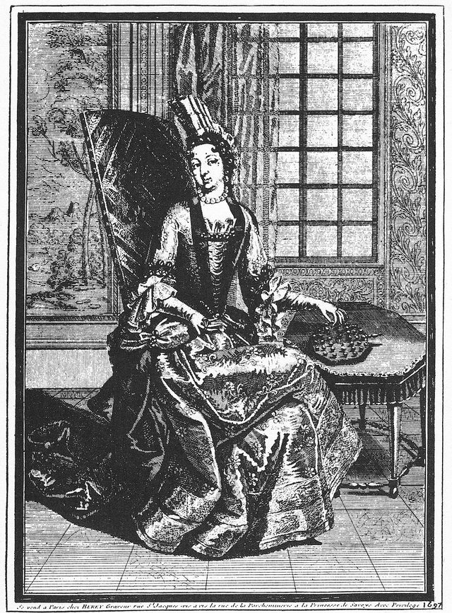

# Peg solitaire

**Encyclopedia ID 4849** (permanent) · https://bpupadhyaya.github.io/world-heritage-games-site/games/4849-peg-solitaire/

*Photo: Claude Auguste Berey, [Public domain](https://creativecommons.org/publicdomain/mark/1.0/), [source on Wikimedia Commons](https://commons.wikimedia.org/wiki/File:Peg_Solitaire_1687_on_Portrait_of_Princess_Soubise_by_Claude-Auguste_Berey.jpg)*

The classic jumping puzzle from the French court, on a lit wooden board with glass pegs.

## How it is played

A jump goes in a straight line over one neighbouring peg into an empty hole. The peg you jumped is removed. On the Triangle board pegs can also jump along both diagonals.

## Heritage note

Part of the living heritage of France.

## Origins

Usually placed in the era of Modern Heritage (1800 to today), although its exact origins are uncertain, within the cultural world of Celtic and Atlantic Europe.

## Facts

- **Where:** France
- **Type:** Puzzles and mind games
- **Family:** Puzzle and dexterity toys
- **Era:** [Modern Heritage](../../eras/modern/index.md) (uncertain)
- **Cradle:** [Celtic and Atlantic Europe](../../cradles/celtic-atlantic/index.md)
- **Region:** Europe

## Play it

[Try a 90-second preview in your browser](https://bpupadhyaya.github.io/games-site/games/peg-solitaire-board/play/) · [Google Play](https://play.google.com/store/apps/details?id=com.equalinformation.arcforge.shell) · [App Store](https://apps.apple.com/us/app/arcforge-world-heritage-games/id6813746442)

## Related entries

- [Tower of Hanoi](../../games/4976-tower-of-hanoi/index.md)
- [Diabolo](../../games/5023-diabolo/index.md)
- [Disc-flip](../../games/8-disc-flip/index.md)
- [Sjoelen](../../games/9-sjoelen/index.md)
- [Shove ha'penny](../../games/54-shove-hapenny/index.md)
- [Cynghanedd Poetry Puzzle](../../games/1448-cynghanedd-poetry-puzzle/index.md)

## Sources

- <https://en.wikipedia.org/wiki/Peg_solitaire>
