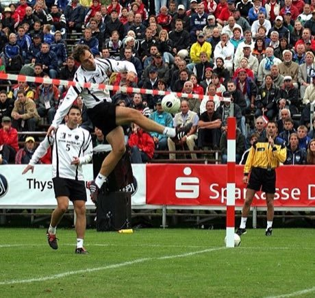

# Faustball

*Also known as: fist ball*

**Encyclopedia ID 485** (permanent) · https://bpupadhyaya.github.io/world-heritage-games-site/games/485-faustball/

*Photo: Flingeflung, [CC BY-SA 3.0](https://creativecommons.org/licenses/by-sa/3.0/), [source on Wikimedia Commons](https://commons.wikimedia.org/wiki/File:Fistball_Spike.jpg)*

Two teams hit a ball over a low line with their fist or forearm, allowing one bounce per side and up to three touches.

## Heritage note

Part of the living heritage of Germany, Austria, Brazil.

## Origins

A living tradition passed from person to person; it is not tied to a single dated origin. It belongs to the cultural world of Northern and Eastern Europe.

## Facts

- **Where:** Germany, Austria, Brazil
- **Type:** Other traditions
- **Family:** Water sports
- **Era:** [Living Traditions](../../eras/living/index.md) (uncertain)
- **Cradle:** [Northern and Eastern Europe](../../cradles/north-east-europe/index.md)
- **Region:** Europe

## Related entries

- [Fijiri Pearl-Diver Sea Songs](../../games/1280-fijiri-pearl-diver-sea-songs/index.md)
- [Water Polo Sprint](../../games/1398-water-polo-sprint/index.md)
- [Ice Canoe Race](../../games/1412-ice-canoe-race/index.md)
- [Jangada Sailing](../../games/1413-jangada-sailing/index.md)
- [Bequia Boat and Model Builder](../../games/1440-bequia-boat-and-model-builder/index.md)
- [Ecuavoley](../../games/1450-ecuavoley/index.md)

## Sources

- <https://commons.wikimedia.org/wiki/File:Fistball_Spike.jpg>
