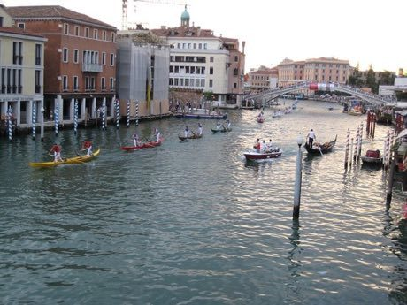

# Venetian lagoon regatta

*Also known as: Regata · gondolino*

**Encyclopedia ID 486** (permanent) · https://bpupadhyaya.github.io/world-heritage-games-site/games/486-venetian-lagoon-regatta/

*Photo: Godromil, [Public domain](https://creativecommons.org/publicdomain/mark/1.0/), [source on Wikimedia Commons](https://commons.wikimedia.org/wiki/File:Venezia_-_Regata_Storica_-_Gondolini_01.jpg)*

Pairs of rowers in narrow lagoon craft race a canal course.

## Heritage note

Part of the living heritage of Italy. Some forms of this practice carry deep meaning for the communities who keep it; here we describe the play and the craft only, with respect for its roots.

## Origins

Usually placed in the era of Age of Contact and Craft (about 1500 to 1800), although its exact origins are uncertain, within the cultural world of Mediterranean.

## Facts

- **Where:** Italy
- **Type:** Racing
- **Family:** Water sports
- **Era:** [Age of Contact and Craft](../../eras/contact/index.md) (uncertain)
- **Cradle:** [Mediterranean](../../cradles/mediterranean/index.md)
- **Region:** Europe

## Related entries

- [Nouka Baich](../../games/42-nouka-baich/index.md)
- [Pirogue coastal canoe race](../../games/56-pirogue-coastal-canoe-race/index.md)
- [Nile Felucca Sailing](../../games/216-nile-felucca-sailing/index.md)
- [Shikara paddle race](../../games/265-shikara-paddle-race/index.md)
- [Hanetsuki](../../games/347-hanetsuki/index.md)
- [Ngalawa outrigger sailing](../../games/1259-ngalawa-outrigger-sailing/index.md)

## Sources

- <https://commons.wikimedia.org/wiki/File:Venezia_-_Regata_Storica_-_Gondolini_01.jpg>
