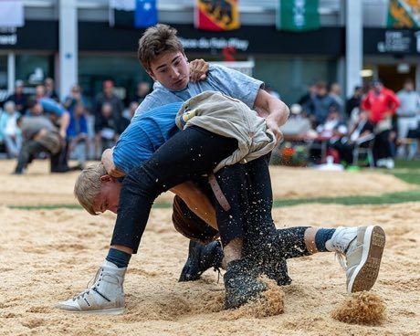

# Swiss wrestling

*Schwingen*

**Encyclopedia ID 487** (permanent) · https://bpupadhyaya.github.io/world-heritage-games-site/games/487-swiss-wrestling/

*Photo: Quejaytee, [CC BY-SA 4.0](https://creativecommons.org/licenses/by-sa/4.0/), [source on Wikimedia Commons](https://commons.wikimedia.org/wiki/File:Wrestlers_at_the_2026_F%C3%AAte_Romande_de_Lutte_Suisse_37.jpg)*

Two wrestlers in a sawdust ring grip the sturdy shorts of the opponent and try to put him on his back with a throw; round is scored by points.

## Heritage note

Part of the living heritage of Switzerland.

## Origins

Usually placed in the era of River Valleys and First Cities (about 3000 to 1000 BCE), although its exact origins are uncertain, within the cultural world of Northern and Eastern Europe.

## Facts

- **Where:** Switzerland
- **Type:** Wrestling and martial sports
- **Family:** Wrestling
- **Era:** [River Valleys and First Cities](../../eras/river-valleys/index.md) (uncertain)
- **Cradle:** [Northern and Eastern Europe](../../cradles/north-east-europe/index.md)
- **Region:** Europe

## Related entries

- [Trânta](../../games/1386-tranta/index.md)
- [Laamb Wrestling Bout](../../games/166-laamb-wrestling-bout/index.md)
- [Kurash](../../games/253-kurash/index.md)
- [Kushti / Pehlwani mud wrestling](../../games/256-kushti-pehlwani-mud-wrestling/index.md)
- [Sumo bout](../../games/359-sumo-bout/index.md)
- [Ssireum](../../games/366-ssireum/index.md)

## Sources

- <https://commons.wikimedia.org/wiki/File:Wrestlers_at_the_2026_F%C3%AAte_Romande_de_Lutte_Suisse_37.jpg>
