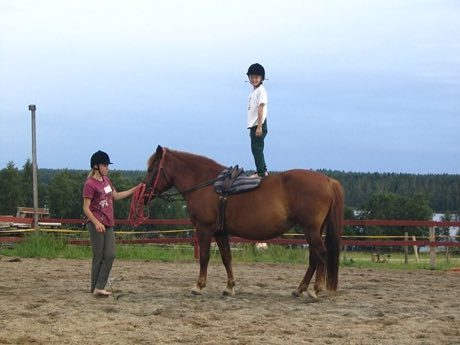

# Equestrian vaulting

*Also known as: Voltigieren*

**Encyclopedia ID 488** (permanent) · https://bpupadhyaya.github.io/world-heritage-games-site/games/488-equestrian-vaulting/

*Photo: Anneli Salo, [CC BY-SA 4.0](https://creativecommons.org/licenses/by-sa/4.0/), [source on Wikimedia Commons](https://commons.wikimedia.org/wiki/File:Vaulting_C_IMG_0434.JPG)*

A gymnast performs a compulsory move sequence on a horse cantering in a circle.

## Heritage note

A tradition shared by communities in many places. Animals are partners in this tradition; good care and local rules always come first.

## Origins

Usually placed in the era of Classical Worlds (about 1000 BCE to 500 CE), although its exact origins are uncertain.

## Facts

- **Where:** Shared across many places
- **Type:** Sports with animal partners
- **Family:** Horse and animal sports
- **Era:** [Classical Worlds](../../eras/classical/index.md) (uncertain)
- **Cradle:** [Shared across the world](../../cradles/worldwide/index.md)
- **Region:** Europe

## Related entries

- [Cirit](../../games/156-cirit/index.md)
- [Tbourida](../../games/164-tbourida/index.md)
- [Slovene quintain](../../games/1073-slovene-quintain/index.md)
- [Champ de Mars turf](../../games/1253-champ-de-mars-turf/index.md)
- [Encang kuda](../../games/1067-encang-kuda/index.md)
- [Turkmen Akhal-Teke equestrian games](../../games/1170-turkmen-akhal-teke-equestrian-games/index.md)

## Sources

- <https://commons.wikimedia.org/wiki/File:Vaulting_C_IMG_0434.JPG>
