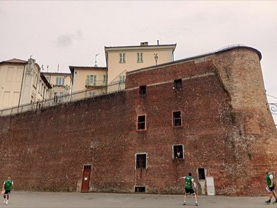

# Tamburello

*Also known as: drum racket*

**Encyclopedia ID 489** (permanent) · https://bpupadhyaya.github.io/world-heritage-games-site/games/489-tamburello/

*Photo: Jeanne Griffin, [CC BY-SA 4.0](https://creativecommons.org/licenses/by-sa/4.0/), [source on Wikimedia Commons](https://commons.wikimedia.org/wiki/File:Ricetto_tamburello_games_Portacamaro_(AT)_19-7-2025.jpg)*

Two teams hit a ball with a drum-like frame, which resembles a tambourine, across a court, scoring in tennis-like games.

## Heritage note

Part of the living heritage of Italy, France.

## Origins

A living tradition passed from person to person; it is not tied to a single dated origin. It belongs to the cultural world of Mediterranean.

## Facts

- **Where:** Italy, France
- **Type:** Crafts and making
- **Family:** Drums and percussion
- **Era:** [Living Traditions](../../eras/living/index.md)
- **Cradle:** [Mediterranean](../../cradles/mediterranean/index.md)
- **Region:** Europe

## Related entries

- [Talking drum](../../games/33-talking-drum/index.md)
- [Tabla Bol Rhythm](../../games/35-tabla-bol-rhythm/index.md)
- [Marimba](../../games/52-marimba/index.md)
- [Shekere gourd rattle](../../games/125-shekere-gourd-rattle/index.md)
- [Madal drum](../../games/147-madal-drum/index.md)
- [Calabash Water Drum](../../games/180-calabash-water-drum/index.md)

## Sources

- <https://commons.wikimedia.org/wiki/File:Ricetto_tamburello_games_Portacamaro_(AT)_19-7-2025.jpg>
