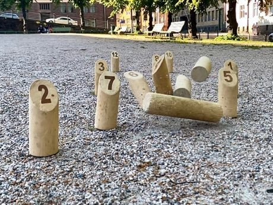

# Finnish pin toss

*Also known as: Mölkky*

**Encyclopedia ID 49** (permanent) · https://bpupadhyaya.github.io/world-heritage-games-site/games/49-finnish-pin-toss/

*Photo: Lasse Keskinen, [CC BY-SA 4.0](https://creativecommons.org/licenses/by-sa/4.0/), [source on Wikimedia Commons](https://commons.wikimedia.org/wiki/File:Mölkky_game.jpg)*

Throw a wooden pin underhand at 12 numbered skittles; one toppled pin scores its number, several score the count, first to exactly 50 wins (overshoot drops to 25).

## Heritage note

Part of the living heritage of Finland.

## Origins

Usually placed in the era of Age of Contact and Craft (about 1500 to 1800), although its exact origins are uncertain, within the cultural world of Northern and Eastern Europe.

## Facts

- **Where:** Finland
- **Type:** Dexterity and skill games
- **Family:** Winter sports
- **Era:** [Age of Contact and Craft](../../eras/contact/index.md) (uncertain)
- **Cradle:** [Northern and Eastern Europe](../../cradles/north-east-europe/index.md)
- **Region:** Europe
- **Players:** 2-12

## Play it

[Web preview](https://bpupadhyaya.github.io/) · [Google Play](https://play.google.com/store/apps/details?id=com.equalinformation.arcforge.shell) · [App Store](https://apps.apple.com/us/app/arcforge-world-heritage-games/id6813746442)

## Related entries

- [Kicksled Race](../../games/407-kicksled-race/index.md)
- ['Ulu Maika](../../games/44-ulu-maika/index.md)
- [Sled dog race](../../games/62-sled-dog-race/index.md)
- [Canal ice-skating marathon](../../games/84-canal-ice-skating-marathon/index.md)
- [Candlepin bowling](../../games/444-candlepin-bowling/index.md)
- [Luge and toboggan run](../../games/482-luge-and-toboggan-run/index.md)

## Sources

- <https://commons.wikimedia.org/wiki/File:Mölkky_game.jpg>
- <https://en.wikipedia.org/wiki/M%C3%B6lkky>
- <https://en.biginfinland.com/molkky-summer-finnish-game/>
