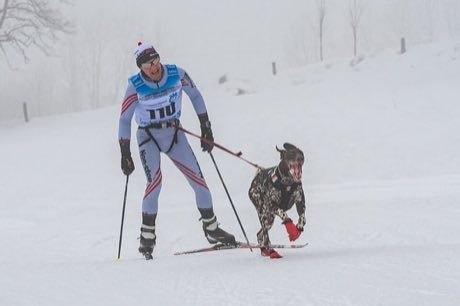

# Skijoring

**Encyclopedia ID 490** (permanent) · https://bpupadhyaya.github.io/world-heritage-games-site/games/490-skijoring/

*Photo: Isiwal, [CC BY-SA 4.0](https://creativecommons.org/licenses/by-sa/4.0/), [source on Wikimedia Commons](https://commons.wikimedia.org/wiki/File:Werfenweng_2018_Skij%C3%B6ring_Herren_1_Hund_Kategorie_3_NEUBERT_Ivo-8126.jpg)*

A skier is towed by a dog or horse along a snow course with jumps and gates; the player steers and balances speed.

## Heritage note

A tradition shared by communities in many places. Animals are partners in this tradition; good care and local rules always come first.

## Origins

Usually placed in the era of Classical Worlds (about 1000 BCE to 500 CE), although its exact origins are uncertain.

## Facts

- **Where:** Shared across many places
- **Type:** Sports with animal partners
- **Family:** Winter sports
- **Era:** [Classical Worlds](../../eras/classical/index.md) (uncertain)
- **Cradle:** [Shared across the world](../../cradles/worldwide/index.md)
- **Region:** Americas

## Related entries

- [Kottabos Symposium Toss](../../games/392-kottabos-symposium-toss/index.md)
- [Barrel racing](../../games/439-barrel-racing/index.md)
- [Malha](../../games/1466-malha/index.md)
- [Chinlone](../../games/16-chinlone/index.md)
- ['Ulu Maika](../../games/44-ulu-maika/index.md)
- [Finnish pin toss](../../games/49-finnish-pin-toss/index.md)

## Sources

- <https://commons.wikimedia.org/wiki/File:Werfenweng_2018_Skij%C3%B6ring_Herren_1_Hund_Kategorie_3_NEUBERT_Ivo-8126.jpg>
