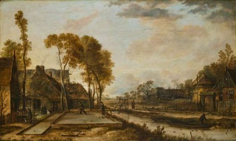

# Kolf

*Also known as: Dutch club-and-ball*

**Encyclopedia ID 491** (permanent) · https://bpupadhyaya.github.io/world-heritage-games-site/games/491-kolf/

*Photo: Aert van der Neer, [Public domain](https://creativecommons.org/publicdomain/mark/1.0/), [source on Wikimedia Commons](https://commons.wikimedia.org/wiki/File:Evening_Game_of_Kolf_in_a_Dutch_Village_CZE_NG.O_123.jpeg)*

Players hit a ball with a club toward a post at the far end of a court, with fewest strokes winning.

## Heritage note

Part of the living heritage of Netherlands.

## Origins

Usually placed in the era of Classical Worlds (about 1000 BCE to 500 CE), although its exact origins are uncertain, within the cultural world of Celtic and Atlantic Europe.

## Facts

- **Where:** Netherlands
- **Type:** Archery, throwing and target games
- **Era:** [Classical Worlds](../../eras/classical/index.md) (uncertain)
- **Cradle:** [Celtic and Atlantic Europe](../../cradles/celtic-atlantic/index.md)
- **Region:** Europe

## Play it

[Try a 90-second preview in your browser](https://bpupadhyaya.github.io/games-site/games/kolf/play/) · [Google Play](https://play.google.com/store/apps/details?id=com.equalinformation.arcforge.shell) · [App Store](https://apps.apple.com/us/app/arcforge-world-heritage-games/id6813746442)

## Related entries

- [Krulbol](../../games/1469-krulbol/index.md)
- [Lawn bowls](../../games/74-lawn-bowls/index.md)
- [Basque stone lifting](../../games/479-basque-stone-lifting/index.md)
- [Langspil](../../games/1323-langspil/index.md)
- [Boules lyonnaises](../../games/730-boules-lyonnaises/index.md)
- [Provencal boules](../../games/939-provencal-boules/index.md)

## Sources

- <https://commons.wikimedia.org/wiki/File:Evening_Game_of_Kolf_in_a_Dutch_Village_CZE_NG.O_123.jpeg>
