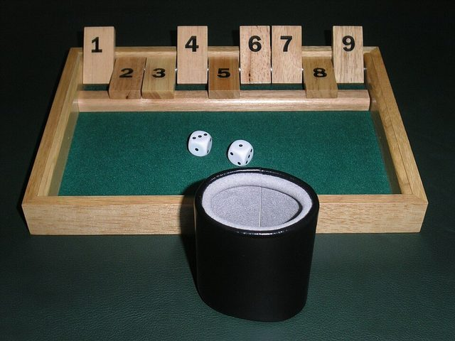

# Shut the Box

**Encyclopedia ID 4915** (permanent) · https://bpupadhyaya.github.io/world-heritage-games-site/games/4915-shut-the-box/

*Photo: Roland Scheicher / Roland Scheicher at German Wikipedia, [Public domain](https://creativecommons.org/publicdomain/mark/1.0/), [source on Wikimedia Commons](https://commons.wikimedia.org/wiki/File:Shut_the_box.jpg)*

Shut the Box is a tavern dice game for one or more players, using a wooden box with a row of numbered tiles that flip down to be 'shut'. It is traditionally said to have begun among fishermen in Normandy in northern France and then to have crossed the Channel to England, where it was played in pubs and homes for generations. Its older English name was Batten Down the Hatches, a nautical phrase that reflects its seafaring reputation.

## How it is played

The box has nine tiles numbered 1 to 9, all standing open. On a turn the player rolls two dice and adds them, then flips down any open tiles that add up to the total, so a roll of 8 may close the 8, or 5 and 3, or 6 and 2, or 1, 2 and 5. The player keeps rolling and closing tiles until no combination of open tiles can match the roll. The score is the sum of the tiles left open, lower is better, and shutting every tile, the 'shut', is a perfect game.

## Heritage note

The game was a staple of English pubs and ships and in time found its way to North America, Germany and other countries, where it is sold under local names. A box of finely made tiles and a pair of bone or wooden dice is a common sight in curiosity shops and family cupboards. Because the choices are real, the player can choose between a safe small tile and a risky large one, and experienced players learn the odds of each sum. The same maths is used in classrooms to teach probability and number bonds to children.

## Origins

Said to have started as a Norman fishermen's tavern game in the 1100s, the earliest firm records of the box game date from the 19th century in England and France.

## Facts

- **Where:** France
- **Type:** Board and table games
- **Family:** Dice and knucklebone games
- **Era:** [River Valleys and First Cities](../../eras/river-valleys/index.md) (uncertain)
- **Cradle:** [Celtic and Atlantic Europe](../../cradles/celtic-atlantic/index.md)
- **Region:** Europe

## Play it

[Try a 90-second preview in your browser](https://bpupadhyaya.github.io/games-site/games/shut-the-box-tiles/play/) · [Google Play](https://play.google.com/store/apps/details?id=com.equalinformation.arcforge.shell) · [App Store](https://apps.apple.com/us/app/arcforge-world-heritage-games/id6813746442)

## Related entries

- [Sho](../../games/286-sho/index.md)
- [Liubo](../../games/331-liubo/index.md)
- [E-sugoroku](../../games/348-e-sugoroku/index.md)
- [Generala](../../games/422-generala/index.md)
- [Game of the Goose](../../games/450-game-of-the-goose/index.md)
- [Sáhkku](../../games/451-sahkku/index.md)

## Sources

- <https://en.wikipedia.org/wiki/Shut_the_box>
