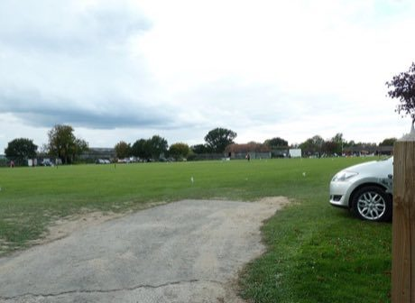

# Stoolball

*Stoolball*

**Encyclopedia ID 492** (permanent) · https://equalinformation.com/world-heritage-games-site/games/492-stoolball/

*Photo: Richard Rogerson, [CC BY-SA 2.0](https://creativecommons.org/licenses/by-sa/2.0/), [source on Wikimedia Commons](https://commons.wikimedia.org/wiki/File:Smallfield_Ladies_Stoolball_Team_playing_at_Dorking,_in_the_shadow_of_Box_Hill_-_geograph.org.uk_-_1386612.jpg)*

A bowler throws underarm at a wooden target on a post; the batter defends it with a paddle bat and runs between posts to score.

## Heritage note

Part of the living heritage of United Kingdom.

## Origins

Usually placed in the era of Modern Heritage (1800 to today), although its exact origins are uncertain, within the cultural world of Celtic and Atlantic Europe.

## Facts

- **Where:** United Kingdom
- **Type:** Archery, throwing and target games
- **Family:** Bat-and-ball games
- **Era:** [Modern Heritage](../../eras/modern/index.md) (uncertain)
- **Cradle:** [Celtic and Atlantic Europe](../../cradles/celtic-atlantic/index.md)
- **Region:** Europe

## Related entries

- [Lapta](../../games/375-lapta/index.md)
- [Pesapallo](../../games/484-pesapallo/index.md)
- [Four Corners](../../games/652-four-corners/index.md)
- [Rounders](../../games/761-rounders/index.md)
- [Gilli-Danda](../../games/793-gilli-danda/index.md)
- [Disc-flip](../../games/8-disc-flip/index.md)

## Sources

- <https://commons.wikimedia.org/wiki/File:Smallfield_Ladies_Stoolball_Team_playing_at_Dorking,_in_the_shadow_of_Box_Hill_-_geograph.org.uk_-_1386612.jpg>
