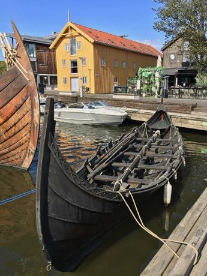

# Clinker Boat Building

*Klinkbygd skip (Nordic)*

**Encyclopedia ID 496** (permanent) · https://bpupadhyaya.github.io/world-heritage-games-site/games/496-clinker-boat-building/

*Photo: Wolfmann, [CC BY-SA 4.0](https://creativecommons.org/licenses/by-sa/4.0/), [source on Wikimedia Commons](https://commons.wikimedia.org/wiki/File:T%C3%B8nsberg_Norway_S%C3%A6heimr_(Fj%C3%B8rtoftb%C3%A5ten)_Viking_ship_row_sail_boat_replicas_Harbour_Havn_Pier_Board_walk_Dock_Brygga_Sense_Foynhagen_restaurants_wooden_buildings_Vikingodden_Lindahlplan_etc_2019-08-21_0019.jpg)*

Shape and fasten overlapping hull planks (strakes) one by one around a keel and ribs, riveting them in order so the hull keeps its shape, then launch and test the vessel.

## Heritage note

Part of the living heritage of Norway, Denmark, Netherlands.

## Origins

A living tradition passed from person to person; it is not tied to a single dated origin. It belongs to the cultural world of Northern and Eastern Europe.

## Facts

- **Where:** Norway, Denmark, Netherlands
- **Type:** Crafts and making
- **Era:** [Living Traditions](../../eras/living/index.md)
- **Cradle:** [Northern and Eastern Europe](../../cradles/north-east-europe/index.md)
- **Region:** Europe

## Related entries

- [Rosemaling](../../games/120-rosemaling/index.md)
- [Hardanger Fiddle Halling](../../games/520-hardanger-fiddle-halling/index.md)
- [Faroese chain dance](../../games/1276-faroese-chain-dance/index.md)
- [Hardanger embroidery](../../games/1296-hardanger-embroidery/index.md)
- [Lur pitch-and-breath game](../../games/1329-lur-pitch-and-breath-game/index.md)
- [Matryoshka](../../games/28-matryoshka/index.md)

## Sources

- <https://commons.wikimedia.org/wiki/File:T%C3%B8nsberg_Norway_S%C3%A6heimr_(Fj%C3%B8rtoftb%C3%A5ten)_Viking_ship_row_sail_boat_replicas_Harbour_Havn_Pier_Board_walk_Dock_Brygga_Sense_Foynhagen_restaurants_wooden_buildings_Vikingodden_Lindahlplan_etc_2019-08-21_0019.jpg>
