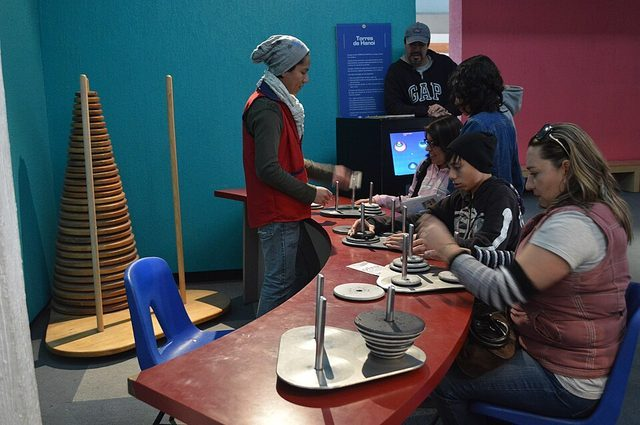

# Tower of Hanoi

**Encyclopedia ID 4976** (permanent) · https://bpupadhyaya.github.io/world-heritage-games-site/games/4976-tower-of-hanoi/

*Photo: AlejandroLinaresGarcia, [CC BY-SA 3.0](https://creativecommons.org/licenses/by-sa/3.0/), [source on Wikimedia Commons](https://commons.wikimedia.org/wiki/File:UniversumUNAM34.JPG)*

The Tower of Hanoi was invented in 1883 by the French mathematician Edouard Lucas, who published it under the pseudonym 'N. Claus de Siam', an anagram of 'Lucas d'Amiens', after his home town. It was sold as a toy with a printed legend of 64 golden discs moved by patient attendants in a far-off tower, and the name refers to Hanoi, then a city of French Indochina. Lucas was a leader of the recreational mathematics movement, and the puzzle quickly became a favourite of teachers and parents.

## How it is played

Three pegs stand in a row, and a stack of discs of different sizes starts on the first, with the smallest on top. The player must move the whole stack to another peg, one disc at a time, never placing a larger disc on a smaller one. The smallest number of moves for a stack of n discs is 2 to the power n, minus 1, so three discs need 7 moves, and the legendary 64 would need about 18 quintillion. The strategy is to move the stack above the largest disc away, move that disc, then rebuild on top of it.

## Heritage note

The puzzle is among the most studied in mathematics and computing. It is a standard classroom example of recursion, because the solution for n discs uses the solution for n minus 1 discs twice. Its sequence of moves follows the binary Gray code, and psychologists have used it to study planning and problem solving in children and in patients recovering from brain injury. Wooden versions with coloured discs are sold around the world, and it has appeared in stories and films as a symbol of patient, step-by-step effort.

## Origins

Invented and patented in Paris in 1883 by Edouard Lucas, a French mathematician, and sold under a Tonkin-inspired fictional legend.

## Facts

- **Where:** France
- **Type:** Puzzles and mind games
- **Family:** Puzzle and dexterity toys
- **Era:** [Modern Heritage](../../eras/modern/index.md) (uncertain)
- **Cradle:** [Celtic and Atlantic Europe](../../cradles/celtic-atlantic/index.md)
- **Region:** Europe

## Play it

[Try a 90-second preview in your browser](https://bpupadhyaya.github.io/games-site/games/hanoi-tower-discs/play/) · [Google Play](https://play.google.com/store/apps/details?id=com.equalinformation.arcforge.shell) · [App Store](https://apps.apple.com/us/app/arcforge-world-heritage-games/id6813746442)

## Related entries

- [Peg solitaire](../../games/4849-peg-solitaire/index.md)
- [Diabolo](../../games/5023-diabolo/index.md)
- [Disc-flip](../../games/8-disc-flip/index.md)
- [Sjoelen](../../games/9-sjoelen/index.md)
- [Shove ha'penny](../../games/54-shove-hapenny/index.md)
- [Cynghanedd Poetry Puzzle](../../games/1448-cynghanedd-poetry-puzzle/index.md)

## Sources

- <https://en.wikipedia.org/wiki/Tower_of_Hanoi>
