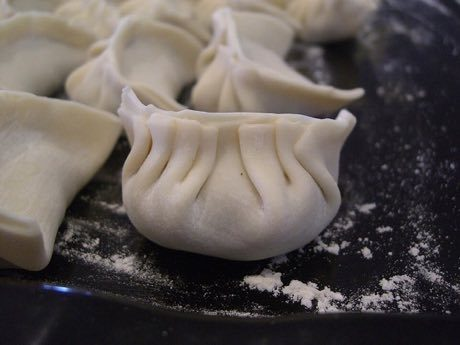

# Dumpling Pleating

*饺子 jiaozi / momo / gyoza*

**Encyclopedia ID 499** (permanent) · https://equalinformation.com/world-heritage-games-site/games/499-dumpling-pleating/

*Photo: avlxyz, [CC BY-SA 2.0](https://creativecommons.org/licenses/by-sa/2.0/), [source on Wikimedia Commons](https://commons.wikimedia.org/wiki/File:8-pleats_-_Julia%27s_Beef_and_Chinese_Celery_Dumplings.jpg)*

Fill a wrapper and pinch pleats in order along one edge so the dumpling seals and stands up, matching regional shapes (crescent, purse, braid).

## Heritage note

Part of the living heritage of China, Nepal, Japan.

## Origins

A living tradition passed from person to person; it is not tied to a single dated origin. It belongs to the cultural world of China.

## Facts

- **Where:** China, Nepal, Japan
- **Type:** Crafts and making
- **Family:** Winter sports
- **Era:** [Living Traditions](../../eras/living/index.md)
- **Cradle:** [China](../../cradles/china/index.md)
- **Region:** East and Southeast Asia

## Related entries

- [Bamboo scaffold builder](../../games/369-bamboo-scaffold-builder/index.md)
- [Neon sign bender](../../games/371-neon-sign-bender/index.md)
- [Hong Kong Milk Tea Pulling](../../games/1463-hong-kong-milk-tea-pulling/index.md)
- [Plate Spinning](../../games/73-plate-spinning/index.md)
- [Wire car](../../games/85-wire-car/index.md)
- [Maple taffy on snow](../../games/441-maple-taffy-on-snow/index.md)

## Sources

- <https://commons.wikimedia.org/wiki/File:8-pleats_-_Julia%27s_Beef_and_Chinese_Celery_Dumplings.jpg>
