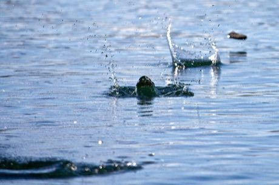

# Stone Skipping

*Stone skimming / Ducks and drakes*

**Encyclopedia ID 5** (permanent) · https://equalinformation.com/world-heritage-games-site/games/5-stone-skipping/

*Photo: Killy Ridols, [CC BY-SA 2.0](https://creativecommons.org/licenses/by-sa/2.0/), [source on Wikimedia Commons](https://commons.wikimedia.org/wiki/File:Stone_skimming_-Patagonia-9Mar2010.jpg)*

Pick a flat stone, set angle, spin and speed with a flick, and try to skip it as many times as possible across the water.

## Heritage note

A tradition shared by communities in many places.

## Origins

Usually placed in the era of Modern Heritage (1800 to today), although its exact origins are uncertain.

## Facts

- **Where:** Shared across many places
- **Type:** Puzzles and mind games
- **Family:** Puzzle and dexterity toys
- **Era:** [Modern Heritage](../../eras/modern/index.md) (uncertain)
- **Cradle:** [Shared across the world](../../cradles/worldwide/index.md)
- **Region:** Worldwide

## Related entries

- [Kingyo-sukui](../../games/3-kingyo-sukui/index.md)
- [Disc-flip](../../games/8-disc-flip/index.md)
- [Sjoelen](../../games/9-sjoelen/index.md)
- [Shove ha'penny](../../games/54-shove-hapenny/index.md)
- [Limbo](../../games/58-limbo/index.md)
- [Daruma Otoshi](../../games/63-daruma-otoshi/index.md)

## Sources

- <https://commons.wikimedia.org/wiki/File:Stone_skimming_-Patagonia-9Mar2010.jpg>
