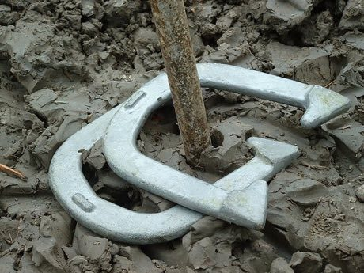

# Horseshoe pitching

*Also known as: Horseshoes*

**Encyclopedia ID 50** (permanent) · https://bpupadhyaya.github.io/world-heritage-games-site/games/50-horseshoe-pitching/

*Photo: unknown (see file page), [CC BY 2.5](https://creativecommons.org/licenses/by/2.5/), [source on Wikimedia Commons](https://commons.wikimedia.org/wiki/File:Horseshoes_game.jpg)*

Pitch a horseshoe about 40 ft at a stake: ringers score 3, closest shoe 1, first to 21.

## Heritage note

Part of the living heritage of United States, Canada. Animals are partners in this tradition; good care and local rules always come first.

## Origins

Usually placed in the era of Classical Worlds (about 1000 BCE to 500 CE), although its exact origins are uncertain, within the cultural world of The Americas: North America.

## Facts

- **Where:** United States, Canada
- **Type:** Dexterity and skill games
- **Family:** Archery and target games
- **Era:** [Classical Worlds](../../eras/classical/index.md) (uncertain)
- **Cradle:** [The Americas: North America](../../cradles/north-america/index.md)
- **Region:** Americas
- **Players:** 2-4

## Play it

[Try a 90-second preview in your browser](https://bpupadhyaya.github.io/games-site/games/horseshoe-pitching/play/) · [Google Play](https://play.google.com/store/apps/details?id=com.equalinformation.arcforge.shell) · [App Store](https://apps.apple.com/us/app/arcforge-world-heritage-games/id6813746442)

## Related entries

- [Mounted Archery Course](../../games/67-mounted-archery-course/index.md)
- [Lawn bowls](../../games/74-lawn-bowls/index.md)
- [Krulbol](../../games/1469-krulbol/index.md)
- [Mongolian Bow Archery](../../games/1476-mongolian-bow-archery/index.md)
- [Archery](../../games/591-archery/index.md)
- [Boules lyonnaises](../../games/730-boules-lyonnaises/index.md)

## Sources

- <https://commons.wikimedia.org/wiki/File:Horseshoes_game.jpg>
- <https://www.horseshoepitching.com/about-us/>
- <https://www.horseshoepitching.com/>
