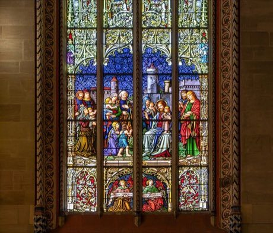

# Leaded Glass Window Making

*Also known as: Stained glass*

**Encyclopedia ID 501** (permanent) · https://bpupadhyaya.github.io/world-heritage-games-site/games/501-leaded-glass-window-making/

*Photo: Terragio67, [CC BY-SA 4.0](https://creativecommons.org/licenses/by-sa/4.0/), [source on Wikimedia Commons](https://commons.wikimedia.org/wiki/File:Saint-Pierre_cathedral,_Geneva_-_Stained_glass_windows_in_the_Chapelle_des_Maccab%C3%A9es_-_Details.jpg)*

Cut coloured glass pieces to a cartoon, fit them with lead came, solder and light the finished window.

## Heritage note

Part of the living heritage of Japan. Some forms of this practice carry deep meaning for the communities who keep it; here we describe the play and the craft only, with respect for its roots.

## Origins

A living tradition passed from person to person; it is not tied to a single dated origin. It belongs to the cultural world of Japan and Korea.

## Facts

- **Where:** Japan
- **Type:** Crafts and making
- **Family:** Pottery, wood and metal crafts
- **Era:** [Living Traditions](../../eras/living/index.md)
- **Cradle:** [Japan and Korea](../../cradles/japan-korea/index.md)
- **Region:** East and Southeast Asia

## Related entries

- [Lost-Wax Bronze Casting](../../games/178-lost-wax-bronze-casting/index.md)
- [Ukiyo-e Woodblock Printing](../../games/1490-ukiyo-e-woodblock-printing/index.md)
- [Kintsugi](../../games/5371-kintsugi/index.md)
- [Wajima-nuri](../../games/11615-wajima-nuri/index.md)
- [Edo kimekomi doll](../../games/11625-edo-kimekomi-doll/index.md)
- [Tsugaru-nuri lacquerware](../../games/14554-tsugaru-nuri-lacquerware/index.md)

## Sources

- <https://commons.wikimedia.org/wiki/File:Saint-Pierre_cathedral,_Geneva_-_Stained_glass_windows_in_the_Chapelle_des_Maccab%C3%A9es_-_Details.jpg>
