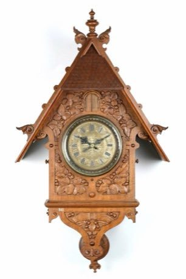

# Clockwork Movement Builder

*Schwarzwalduhr / Kuckucksuhr · Black Forest clock*

**Encyclopedia ID 502** (permanent) · https://bpupadhyaya.github.io/world-heritage-games-site/games/502-clockwork-movement-builder/

*Photo: Deutsches Uhrenmuseum Furtwangen, [CC BY-SA 4.0](https://creativecommons.org/licenses/by-sa/4.0/), [source on Wikimedia Commons](https://commons.wikimedia.org/wiki/File:Cuckoo_clock,_1898.jpg)*

Connect gears, a pendulum and an escapement in the right order so the train drives the hands and pops a bird on the hour; fix mismatched gear ratios.

## Heritage note

Part of the living heritage of Germany, Switzerland, United Kingdom.

## Origins

Usually placed in the era of Modern Heritage (1800 to today), although its exact origins are uncertain, within the cultural world of Northern and Eastern Europe.

## Facts

- **Where:** Germany, Switzerland, United Kingdom
- **Type:** Puzzles and mind games
- **Family:** Puzzle and dexterity toys
- **Era:** [Modern Heritage](../../eras/modern/index.md) (uncertain)
- **Cradle:** [Northern and Eastern Europe](../../cradles/north-east-europe/index.md)
- **Region:** Europe

## Related entries

- [Nail driving](../../games/82-nail-driving/index.md)
- [Kiiking](../../games/66-kiiking/index.md)
- [Ringridning](../../games/1365-ringridning/index.md)
- [Kingyo-sukui](../../games/3-kingyo-sukui/index.md)
- [Stone Skipping](../../games/5-stone-skipping/index.md)
- [Disc-flip](../../games/8-disc-flip/index.md)

## Sources

- <https://commons.wikimedia.org/wiki/File:Cuckoo_clock,_1898.jpg>
