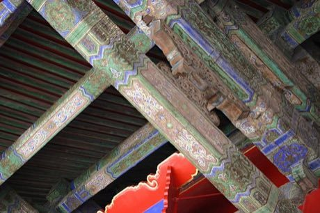

# Dougong Bracket Stacking

*斗拱 dougong*

**Encyclopedia ID 504** (permanent) · https://bpupadhyaya.github.io/world-heritage-games-site/games/504-dougong-bracket-stacking/

*Photo: The war moose, [CC BY-SA 3.0](https://creativecommons.org/licenses/by-sa/3.0/), [source on Wikimedia Commons](https://commons.wikimedia.org/wiki/File:Interlocking_wooden_brackets.jpg)*

Slot interlocking wooden blocks and arms together without nails so they carry a roof beam, choosing the right piece at each layer.

## Heritage note

Part of the living heritage of China, South Korea, Japan.

## Origins

Usually placed in the era of Classical Worlds (about 1000 BCE to 500 CE), although its exact origins are uncertain, within the cultural world of China.

## Facts

- **Where:** China, South Korea, Japan
- **Type:** Puzzles and mind games
- **Family:** Puzzle and dexterity toys
- **Era:** [Classical Worlds](../../eras/classical/index.md) (uncertain)
- **Cradle:** [China](../../cradles/china/index.md)
- **Region:** East and Southeast Asia

## Related entries

- [Egrang](../../games/17-egrang/index.md)
- [Luban lock](../../games/99-luban-lock/index.md)
- [Tavern Nail and Wire Puzzles](../../games/110-tavern-nail-and-wire-puzzles/index.md)
- [Lo Shu Magic Square](../../games/111-lo-shu-magic-square/index.md)
- [Stone Arch Bridge Builder](../../games/495-stone-arch-bridge-builder/index.md)
- [Huarong Dao](../../games/639-huarong-dao/index.md)

## Sources

- <https://commons.wikimedia.org/wiki/File:Interlocking_wooden_brackets.jpg>
