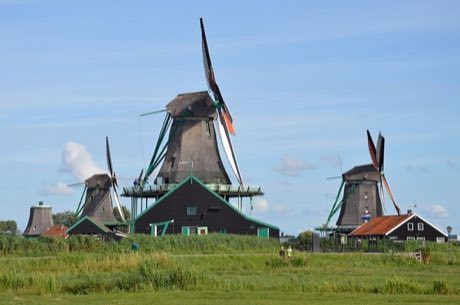

# Windmill Miller

*Molen / Dutch windmill*

**Encyclopedia ID 507** (permanent) · https://bpupadhyaya.github.io/world-heritage-games-site/games/507-windmill-miller/

*Photo: DimiTalen, [CC0](https://creativecommons.org/publicdomain/zero/1.0/), [source on Wikimedia Commons](https://commons.wikimedia.org/wiki/File:Windmills_at_Zaanse_Schans,_Zaanstad,_2022.jpg)*

Turn the windmill cap into the wind, set sail cloth, adjust the millstone gap and feed grain so flour is fine and not burned.

## Heritage note

Part of the living heritage of Netherlands, Spain, Iran.

## Origins

Usually placed in the era of River Valleys and First Cities (about 3000 to 1000 BCE), although its exact origins are uncertain, within the cultural world of Celtic and Atlantic Europe.

## Facts

- **Where:** Netherlands, Spain, Iran, United Kingdom
- **Type:** Puzzles and mind games
- **Family:** Puzzle and dexterity toys
- **Era:** [River Valleys and First Cities](../../eras/river-valleys/index.md) (uncertain)
- **Cradle:** [Celtic and Atlantic Europe](../../cradles/celtic-atlantic/index.md)
- **Region:** Europe

## Related entries

- [Polder Windmill Keeper](../../games/412-polder-windmill-keeper/index.md)
- [Disc-flip](../../games/8-disc-flip/index.md)
- [Sjoelen](../../games/9-sjoelen/index.md)
- [Shove ha'penny](../../games/54-shove-hapenny/index.md)
- [Change Ringing](../../games/1443-change-ringing/index.md)
- [Cynghanedd Poetry Puzzle](../../games/1448-cynghanedd-poetry-puzzle/index.md)

## Sources

- <https://commons.wikimedia.org/wiki/File:Windmills_at_Zaanse_Schans,_Zaanstad,_2022.jpg>
