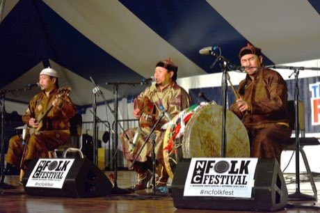

# Tuvan Throat Singing

*Also known as: Khoomei · Хоомей*

**Encyclopedia ID 508** (permanent) · https://bpupadhyaya.github.io/world-heritage-games-site/games/508-tuvan-throat-singing/

*Photo: AjarnRichard, [CC BY-SA 4.0](https://creativecommons.org/licenses/by-sa/4.0/), [source on Wikimedia Commons](https://commons.wikimedia.org/wiki/File:Tuvan_Throat_Singers.jpg)*

Hold a drone with one finger while sliding a second finger to shape overtones and trace a melody above it, scored on stability and melody match.

## Heritage note

Part of the living heritage of Mongolia, Russia.

## Origins

Usually placed in the era of Classical Worlds (about 1000 BCE to 500 CE), although its exact origins are uncertain, within the cultural world of Steppe and Arctic.

## Facts

- **Where:** Mongolia, Russia
- **Type:** Archery, throwing and target games
- **Family:** Rhyme and hand games
- **Era:** [Classical Worlds](../../eras/classical/index.md) (uncertain)
- **Cradle:** [Steppe and Arctic](../../cradles/steppe-arctic/index.md)
- **Region:** East and Southeast Asia

## Related entries

- [Morra](../../games/83-morra/index.md)
- [Finger Hooking](../../games/1452-finger-hooking/index.md)
- [Morin khuur](../../games/34-morin-khuur/index.md)
- [Khomus](../../games/379-khomus/index.md)
- [Mongolian Bow Archery](../../games/1476-mongolian-bow-archery/index.md)
- [Elastic Jump](../../games/6-elastic-jump/index.md)

## Sources

- <https://commons.wikimedia.org/wiki/File:Tuvan_Throat_Singers.jpg>
