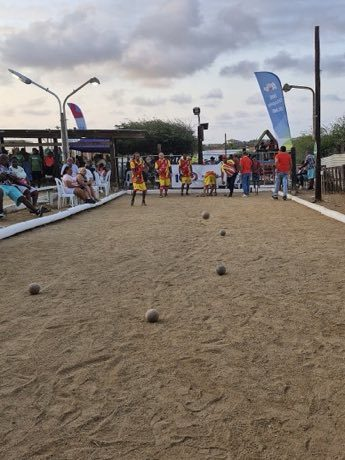

# Bolas criollas

*Bolas criollas*

**Encyclopedia ID 51** (permanent) · https://bpupadhyaya.github.io/world-heritage-games-site/games/51-bolas-criollas/

*Photo: Ginelly.Q, [CC BY 4.0](https://creativecommons.org/licenses/by/4.0/), [source on Wikimedia Commons](https://commons.wikimedia.org/wiki/File:Torneo_Internacional_Bolas_Criollas_Aruba_2025,_Papaya_Ranch_24.jpg)*

Roll or throw heavy balls toward a small white ball (mingo) on a sand court; closest balls score, with hit-and-displace shots.

## Heritage note

Part of the living heritage of Venezuela.

## Origins

Usually placed in the era of Age of Contact and Craft (about 1500 to 1800), although its exact origins are uncertain, within the cultural world of The Americas: Andes and South America.

## Facts

- **Where:** Venezuela
- **Type:** Board and table games
- **Era:** [Age of Contact and Craft](../../eras/contact/index.md) (uncertain)
- **Cradle:** [The Americas: Andes and South America](../../cradles/andes-south-america/index.md)
- **Region:** Americas

## Related entries

- [Bandoneon and tango rhythm](../../games/426-bandoneon-and-tango-rhythm/index.md)
- [Truco](../../games/601-truco/index.md)
- [Joropo llanero band](../../games/130-joropo-llanero-band/index.md)
- [Lotería](../../games/1211-loteria/index.md)
- [Perinola](../../games/1212-perinola/index.md)
- [Charango](../../games/55-charango/index.md)

## Sources

- <https://commons.wikimedia.org/wiki/File:Torneo_Internacional_Bolas_Criollas_Aruba_2025,_Papaya_Ranch_24.jpg>
