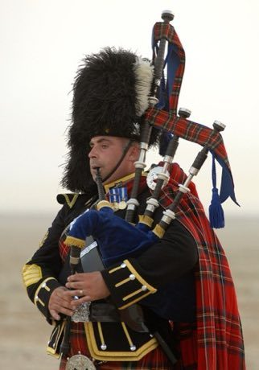

# Highland Bagpipe Chanter and Drone

*Also known as: Piobaireachd · Piping*

**Encyclopedia ID 510** (permanent) · https://bpupadhyaya.github.io/world-heritage-games-site/games/510-highland-bagpipe-chanter-and-drone/

*Photo: Jannine Hartmann, [Public domain](https://creativecommons.org/publicdomain/mark/1.0/), [source on Wikimedia Commons](https://commons.wikimedia.org/wiki/File:Royal_Scots_Dragoon_Guards_piper_Plays_His_Pipes_01.jpg)*

Cover finger holes on a nine-note chanter, add the quick grace notes and play marches and slow airs against a constant drone.

## Heritage note

Part of the living heritage of United Kingdom. It is presented as sport and skill, never as real fighting.

## Origins

Usually placed in the era of Crossroads and Golden Ages (about 500 to 1500), although its exact origins are uncertain, within the cultural world of Celtic and Atlantic Europe.

## Facts

- **Where:** United Kingdom
- **Type:** Musical instruments
- **Family:** Wind instruments
- **Era:** [Crossroads and Golden Ages](../../eras/crossroads/index.md) (uncertain)
- **Cradle:** [Celtic and Atlantic Europe](../../cradles/celtic-atlantic/index.md)
- **Region:** Europe

## Related entries

- [Horn of Africa camel caravan](../../games/1270-horn-of-africa-camel-caravan/index.md)
- [Latvian Bagpipe and Folk Pipes](../../games/1324-latvian-bagpipe-and-folk-pipes/index.md)
- [Mezoued Bagpipe and Tabl Drum](../../games/1336-mezoued-bagpipe-and-tabl-drum/index.md)
- [Croquet](../../games/81-croquet/index.md)
- [Racing Pigeon Loft](../../games/411-racing-pigeon-loft/index.md)
- [Clay Bird Whistle Painting](../../games/1478-clay-bird-whistle-painting/index.md)

## Sources

- <https://commons.wikimedia.org/wiki/File:Royal_Scots_Dragoon_Guards_piper_Plays_His_Pipes_01.jpg>
