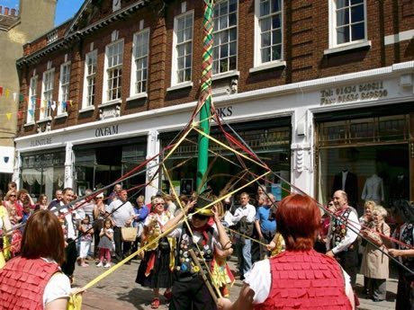

# Ribbon-Pole Plaiting Dance

*Maypole ribbon dance (generic)*

**Encyclopedia ID 512** (permanent) · https://equalinformation.com/world-heritage-games-site/games/512-ribbon-pole-plaiting-dance/

*Photo: JuliaC2006, [CC BY 2.0](https://creativecommons.org/licenses/by/2.0/), [source on Wikimedia Commons](https://commons.wikimedia.org/wiki/File:Maypole_dancing_in_Rochester.jpg)*

Move dancers over and under each other around a central pole so the ribbons plait into named woven patterns such as Spider's Web and Barber's Pole.

## Heritage note

Part of the living heritage of United Kingdom, Germany, Sweden.

## Origins

A living tradition passed from person to person; it is not tied to a single dated origin. It belongs to the cultural world of Celtic and Atlantic Europe.

## Facts

- **Where:** United Kingdom, Germany, Sweden, France, Italy
- **Type:** Dances
- **Family:** Paper, ink and painting crafts
- **Era:** [Living Traditions](../../eras/living/index.md)
- **Cradle:** [Celtic and Atlantic Europe](../../cradles/celtic-atlantic/index.md)
- **Region:** Europe

## Related entries

- [Dots and Boxes](../../games/463-dots-and-boxes/index.md)
- [Paper Fortune Teller](../../games/465-paper-fortune-teller/index.md)
- [Sprouts](../../games/473-sprouts/index.md)
- [Ebru paper marbling](../../games/20-ebru-paper-marbling/index.md)
- [Ndebele geometric wall painting](../../games/23-ndebele-geometric-wall-painting/index.md)
- [Chinese knotting](../../games/26-chinese-knotting/index.md)

## Sources

- <https://commons.wikimedia.org/wiki/File:Maypole_dancing_in_Rochester.jpg>
