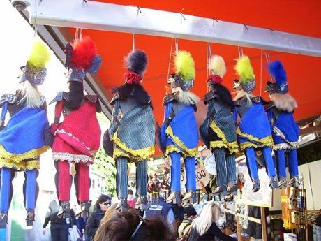

# Sicilian Puppet Knights

*Also known as: Opera dei Pupi*

**Encyclopedia ID 514** (permanent) · https://bpupadhyaya.github.io/world-heritage-games-site/games/514-sicilian-puppet-knights/

*Photo: Dedda71, [Public domain](https://creativecommons.org/publicdomain/mark/1.0/), [source on Wikimedia Commons](https://commons.wikimedia.org/wiki/File:Sicilian_puppet.jpg)*

Stamp, swing and clash armoured rod puppets in rhythm to a storyteller's narration, with the audience-pleasing stamp-and-flourish duel at the heart.

## Heritage note

Part of the living heritage of Italy.

## Origins

Usually placed in the era of Classical Worlds (about 1000 BCE to 500 CE), although its exact origins are uncertain, within the cultural world of Mediterranean.

## Facts

- **Where:** Italy
- **Type:** Performance and storytelling
- **Family:** Puppetry and shadow play
- **Era:** [Classical Worlds](../../eras/classical/index.md) (uncertain)
- **Cradle:** [Mediterranean](../../cradles/mediterranean/index.md)
- **Region:** Europe

## Related entries

- [Aragoz Hand-Puppet Booth](../../games/222-aragoz-hand-puppet-booth/index.md)
- [Water puppet pond theatre](../../games/303-water-puppet-pond-theatre/index.md)
- [Yoke thé](../../games/314-yoke-the/index.md)
- [Morra](../../games/83-morra/index.md)
- [Tbourida](../../games/164-tbourida/index.md)
- [Kottabos Symposium Toss](../../games/392-kottabos-symposium-toss/index.md)

## Sources

- <https://commons.wikimedia.org/wiki/File:Sicilian_puppet.jpg>
