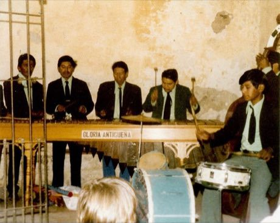

# Marimba

*Also known as: Marimba de Guatemala*

**Encyclopedia ID 52** (permanent) · https://bpupadhyaya.github.io/world-heritage-games-site/games/52-marimba/

*Photo: Infrogmation, [CC BY-SA 4.0](https://creativecommons.org/licenses/by-sa/4.0/), [source on Wikimedia Commons](https://commons.wikimedia.org/wiki/File:Marimba_La_Gloria_Antigueña,_Antigua_Guatemala,_1979.jpg)*

Strike wooden bars with mallets as notes fall, layering melody, harmony and bass of a marimba band.

## Heritage note

A tradition shared by communities in many places.

## Origins

A living tradition passed from person to person; it is not tied to a single dated origin.

## Facts

- **Where:** Shared across many places
- **Type:** Musical instruments
- **Family:** Drums and percussion
- **Era:** [Living Traditions](../../eras/living/index.md)
- **Cradle:** [Shared across the world](../../cradles/worldwide/index.md)
- **Region:** Americas

## Related entries

- [Talking drum](../../games/33-talking-drum/index.md)
- [Tabla Bol Rhythm](../../games/35-tabla-bol-rhythm/index.md)
- [Calabash Water Drum](../../games/180-calabash-water-drum/index.md)
- [Amadinda and embaire](../../games/185-amadinda-and-embaire/index.md)
- [Tombak goblet drum rhythms](../../games/233-tombak-goblet-drum-rhythms/index.md)
- [Dhol drum rhythm](../../games/263-dhol-drum-rhythm/index.md)

## Sources

- <https://commons.wikimedia.org/wiki/File:Marimba_La_Gloria_Antigueña,_Antigua_Guatemala,_1979.jpg>
