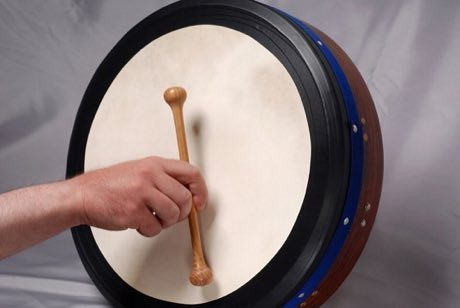

# Bodhran Frame Drum

*Also known as: Bodhrán*

**Encyclopedia ID 521** (permanent) · https://bpupadhyaya.github.io/world-heritage-games-site/games/521-bodhran-frame-drum/

*Photo: Hinnerk R, Hinnerk Rümenapf, [CC BY-SA 3.0](https://creativecommons.org/licenses/by-sa/3.0/), [source on Wikimedia Commons](https://commons.wikimedia.org/wiki/File:177-bodhran-playing-hinnerk-ruemenapf-0067.jpg)*

Strike the skin with a two-ended beater (tipper) while the other hand dampens from behind to change pitch, playing jig and reel patterns in time.

## Heritage note

Part of the living heritage of Ireland.

## Origins

Usually placed in the era of Age of Contact and Craft (about 1500 to 1800), although its exact origins are uncertain, within the cultural world of Celtic and Atlantic Europe.

## Facts

- **Where:** Ireland
- **Type:** Musical instruments
- **Family:** Drums and percussion
- **Era:** [Age of Contact and Craft](../../eras/contact/index.md) (uncertain)
- **Cradle:** [Celtic and Atlantic Europe](../../cradles/celtic-atlantic/index.md)
- **Region:** Europe

## Related entries

- [Steelpan](../../games/31-steelpan/index.md)
- [Bandoneon and tango rhythm](../../games/426-bandoneon-and-tango-rhythm/index.md)
- [Carillon](../../games/418-carillon/index.md)
- [Frisian Road Bowling](../../games/1441-frisian-road-bowling/index.md)
- [Road bowling](../../games/819-road-bowling/index.md)
- [Mbira](../../games/32-mbira/index.md)

## Sources

- <https://commons.wikimedia.org/wiki/File:177-bodhran-playing-hinnerk-ruemenapf-0067.jpg>
- <https://en.wikipedia.org/wiki/Bodhr%C3%A1n>
